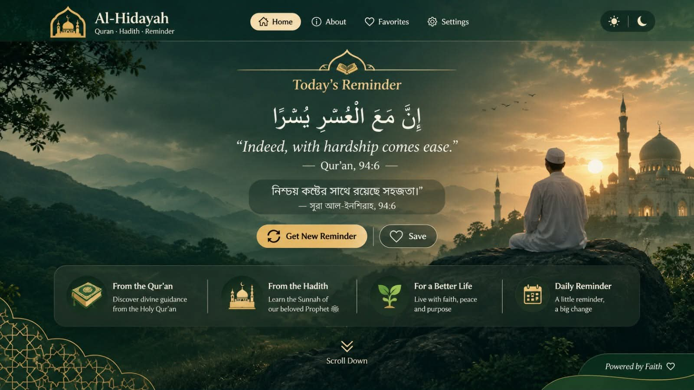
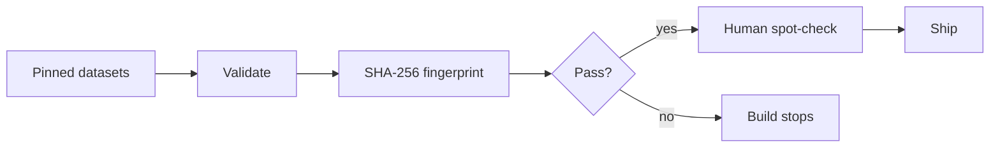

<div align="center">

# Al-Hidayah

**Quran · Hadith · Reminder**

*A few calm minutes each day, in Arabic, English and বাংলা.*




</div>

---

> *Bismillah.* This is a project made with care, for people who will read it with care. If you are about to contribute, please read [AGENTS.md](AGENTS.md) first, even if you are a human. It explains what we will never compromise on.

## What Al-Hidayah is

Al-Hidayah places one verse of the Qur'an or one authentic hadith in front of you each day, with:

| | |
|---|---|
| **Arabic** | the original text, exactly as in the verified source |
| **English** | a named, credited translation |
| **বাংলা** | a named, credited Bangla translation |
| **Reference** | the surah and ayah, or the collection, book and hadith number with its grade |

It is built to be the kind of website you open on a quiet morning, and the kind you are proud to share.

## Where the project stands

**Planning is complete; building has not started.** The documents below are the plan. There is no application code in this repository yet, and the commands in this file describe what will exist after Phase 0. This section will be updated as each phase ships.

| Phase | What | Status |
|---|---|---|
| 0 | Foundations: repo, CI, data pipeline, checksums | Not started |
| 1 | Core experience: reminder, three languages, favorites | Not started |
| 2 | Beauty and motion: design system, 3D hero | Not started |
| 3 | Share Studio, including Send as message | Not started |
| 4 | Prayer times and offline PWA | Not started |
| 5 | Hardening and Release 1.0 | Not started |
| 6 | Management layer for reviewers | Not started |

## The documents

| Read this | If you want to know |
|---|---|
| [`docs/pitch/al-hidayah-pitch.html`](docs/pitch/al-hidayah-pitch.html) | The whole idea in a few minutes, in plain language. Open it in a browser |
| [`docs/01-project-proposal.md`](docs/01-project-proposal.md) | What we are building, why, and under which rules |
| [`docs/02-technical-delivery-plan.md`](docs/02-technical-delivery-plan.md) | The stack, the data pipeline, the security design, the phases |
| [`docs/03-product-design-spec.md`](docs/03-product-design-spec.md) | What every screen looks like and how it behaves |
| [`AGENTS.md`](AGENTS.md) | The working agreement for AI agents (and a good read for people) |

## A walk through the product

This is what a visitor will experience, in order.

1. **You arrive.** The page fades up on a dusk scene: a mosque on a hill, a figure seated in the foreground. A thin gold line draws an arch above *Today's Reminder*, and the Arabic of the day appears in reading order. Then the page goes still.
2. **You read.** Arabic in a beautiful Naskh face, the English beneath it in a quiet italic serif, and the Bangla in a soft panel. Under all three, the exact reference.
3. **You act.** *Get New Reminder* gives you the next item. *Save* keeps it on your device. *Share* opens the Share Studio.
4. **You share.** A live preview shows the exact image you will export: a Facebook post, a Facebook story, an Instagram post, an Instagram story, or the image alone. You can also *send as message*: your phone's share sheet opens and you choose Messenger, WhatsApp or Instagram Direct and pick the person yourself.
5. **You explore.** From the Qur'an. From the Hadith. For a Better Life, where reminders are grouped by theme. Daily Reminder, if you want one each day.
6. **You pray on time.** Prayer times for your city, calculated with the method used in Bangladesh by default, with the next prayer highlighted.
7. **You come back offline.** Install it like an app. Your reminders, favorites and Share Studio work without a connection.

<table>
<tr>
<td width="62%"></td>
<td width="38%"></td>
</tr>
<tr>
<td align="center"><sub>Desktop is the primary experience</sub></td>
<td align="center"><sub>Mobile follows the same story in one column</sub></td>
</tr>
</table>

## Features

- **Random and daily reminders.** A shuffle bag means you will not see the same item twice before you have seen the others. The daily item is the same for everyone on a given date, with no server.
- **Three languages, one reference.** Every item shows its source or it is not shown.
- **Favorites on your device.** No account. Export and import them as a file.
- **Categories.** Browse by theme: patience, gratitude, family, repentance, knowledge and more.
- **Prayer times.** Karachi (University of Islamic Sciences) by default for Bangladesh, with other methods in settings.
- **Share Studio.** Accurate, beautiful images in the shapes platforms use.
- **Dark and light themes,** and a text-size control.
- **Installable and offline.**
- **Hardened by design.** A static site with strict browser security headers, and a courteous deterrent against casual tampering.

## How we keep the scripture correct

This is the part we will not rush. The full rules are in the [proposal, section 7](docs/01-project-proposal.md#7-content-integrity-the-most-important-section).



- The Arabic text is never edited by our code. It is fetched at a fixed version, checked against a reference copy, fingerprinted, and shipped byte for byte.
- Reminders come from a **reviewed pool**, chosen by a qualified person, so a verse is never shown as a fragment out of context. Every item links to *read in context*.
- Hadith in Version 1 come only from Sahih al-Bukhari and Sahih Muslim.
- A build with a single failing check cannot be released.
- AI tools are used for code and design. They are never used to write, translate or tag religious content.
- If you find an error, please [open a content-error issue](../../issues/new/choose). It is treated as the highest-priority kind of report.

## Tech at a glance

| | |
|---|---|
| Site | Astro, TypeScript, small interactive islands |
| Motion and 3D | CSS, GSAP, and Three.js loaded lazily |
| Data | Sharded JSON built from pinned datasets |
| Offline | Service worker with versioned caches |
| Hosting | Cloudflare Pages (free) |
| Later | Cloudflare Workers and D1 for the reviewer dashboard |
| Quality | Vitest, Playwright, axe-core, Lighthouse CI, gitleaks |

The reasoning behind every choice, and what we considered instead, is in the [technical plan](docs/02-technical-delivery-plan.md#4-technology-decisions).

## Running it locally

> These commands describe the project once Phase 0 is complete. Until then they will not work, and this note will be removed when they do.

```bash
# requirements: Node.js (current LTS) and pnpm
git clone https://github.com/<owner>/al-hidayah.git
cd al-hidayah
pnpm install

pnpm data:fetch      # download the pinned datasets
pnpm data:validate   # run every integrity check
pnpm data:build      # generate the site's data
pnpm dev             # start the local server
```

Before you open a pull request:

```bash
pnpm lint && pnpm typecheck
pnpm test
pnpm data:verify
pnpm build
```

## Security

- Static hosting, no accounts and no cookies in Version 1.
- Strict Content-Security-Policy, HSTS and the other recommended headers.
- Secrets live only in environment variables, never in the repository or the browser.
- The later reviewer dashboard uses signed tokens, role checks on every protected route, and an audit log. The backend, not the screen, decides who may do what.
- There are no payments and no donations.
- Please report vulnerabilities privately to the owner, not in a public issue.

## Contributing

Contributions are welcome, and the bar is high because the subject deserves it.

1. Read [AGENTS.md](AGENTS.md). It applies to people as well as AI agents.
2. Keep pull requests small and focused.
3. Never change scripture data in a feature pull request. Data changes are separate, are reviewed by a named person, and update the checksums on purpose.
4. Include tests, and say honestly what you did and did not check.

## Licenses and credits

- **Code:** license to be chosen by the owner before the first release. Until then, all rights reserved.
- **Scripture and translations:** each dataset keeps its own license and is credited in the app and in [`data/LICENSES.md`](data/LICENSES.md). Texts are used unmodified and with attribution.
- **Fonts:** Open Font License, self-hosted.
- **Prayer times:** AlAdhan API.
- **Design mockups:** supplied by the project owner.

Thanks to everyone who maintains open Qur'an and hadith data. This project stands on their work. See the references in each document for the sources.

## FAQ

**Is this a replacement for a scholar?**
No. It is a reminder tool. It offers no rulings. For questions of religion, ask a qualified teacher.

**Why is there no login?**
Because you do not need one, and every account is a responsibility we would rather not take on. Favorites stay on your device.

**Will you ever add ads or donations?**
No.

**Why only Bukhari and Muslim for hadith?**
To keep the grading question simple in Version 1. More collections may follow with review.

**Can you really stop people opening developer tools?**
No, and we say so openly. The site shows a polite *Assalamu Alaikum* to casual attempts, and the real protection is on the server side. See the [proposal, section 8.7](docs/01-project-proposal.md#87-developer-tools-and-right-click-deterrent).

---

## বাংলায় সংক্ষেপে

**আল-হিদায়াহ** একটি ওয়েবসাইট, যেখানে প্রতিদিন কুরআনের একটি আয়াত বা একটি সহিহ হাদিস আরবি, ইংরেজি ও বাংলা অনুবাদসহ নির্ভরযোগ্য সূত্র উল্লেখ করে দেখানো হবে।

- প্রতিটি আয়াত ও হাদিসের সঙ্গে থাকবে সূরা ও আয়াত নম্বর, অথবা হাদিসগ্রন্থ ও নম্বর।
- মূল আরবি পাঠ কখনও পরিবর্তন করা হবে না। বিশেষ যাচাই-প্রক্রিয়া পার না হলে কোনো সংস্করণ প্রকাশ হবে না।
- পছন্দের আয়াত বা হাদিস নিজের ডিভাইসে সংরক্ষণ করা যাবে, কোনো অ্যাকাউন্ট ছাড়াই।
- নামাজের সময়সূচি, দৈনিক স্মরণিকা এবং ছবি আকারে শেয়ার করার সুবিধা থাকবে।
- পুরো প্রকল্প বিনামূল্যে, কোনো বিজ্ঞাপন, ট্র্যাকিং বা অনুদান ছাড়া।

এটি একটি স্মরণ করানোর মাধ্যম। ধর্মীয় সিদ্ধান্তের জন্য অনুগ্রহ করে যোগ্য আলেমের শরণাপন্ন হোন।

---

<div align="center">

*Built with care. May it be of benefit.*

</div>
