<div align="center">


<br>

[](https://al-hidayah-woad.vercel.app/)
[](#-the-complete-quran-reader)
[](#-how-we-keep-the-scripture-correct)


**A few calm minutes each day, with a source you can check.**



</div>

> _Bismillah._ This project is made with care, for people who will read it with care. If you are about to contribute, read [AGENTS.md](AGENTS.md) first, even if you are a human. It explains what we will never compromise on.

<details>
<summary><b>Contents</b></summary>

- [What Al-Hidayah is](#what-al-hidayah-is)
- [The complete Qur'an reader](#-the-complete-quran-reader)
- [Scene themes](#-scene-themes)
- [The footer film and the 404 page](#-the-footer-film-and-the-404-page)
- [Animated logo and icons](#-animated-logo-and-icons)
- [How the pieces fit together](#-how-the-pieces-fit-together)
- [How we keep the scripture correct](#-how-we-keep-the-scripture-correct)
- [Where the project stands](#-where-the-project-stands)
- [Running it locally](#-running-it-locally)
- [Testing and the release gate](#-testing-and-the-release-gate)
- [Deploying](#-deploying)
- [Security](#-security)
- [Contributing, licenses and credits](#-contributing-licenses-and-credits)
- [FAQ](#faq) · [বাংলায় সংক্ষেপে](#বাংলায়-সংক্ষেপে)

</details>

---

## What Al-Hidayah is

Al-Hidayah puts the words of the Qur'an in front of you, one calm page at a time, with:

|               |                                                                              |
| ------------- | ---------------------------------------------------------------------------- |
| **Arabic**    | the original text, exactly as in the verified source                         |
| **English**   | a named, credited translation (Sahih International)                          |
| **বাংলা**     | a named, credited Bangla translation (Muhiuddin Khan)                        |
| **Reference** | the surah and ayah, always shown, never optional                             |

It is built to be the kind of website you open on a quiet morning, and the kind you are proud to share.

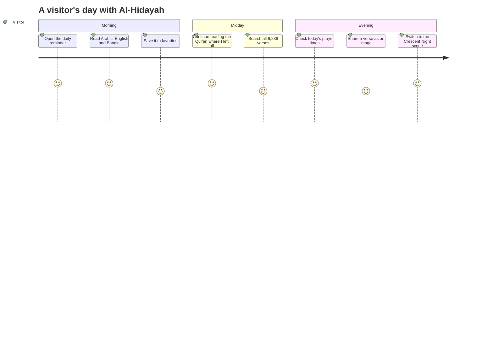

<table>
<tr>
<td width="62%"></td>
<td width="38%">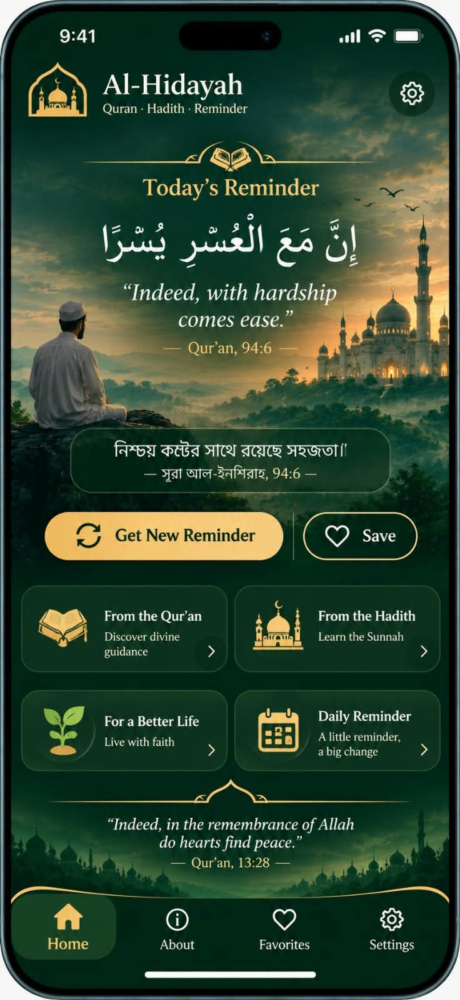</td>
</tr>
<tr>
<td align="center"><sub>Desktop is the primary experience</sub></td>
<td align="center"><sub>Mobile follows the same story in one column</sub></td>
</tr>
</table>

---

## 📖 The complete Qur'an reader

Every surah and every verse is in the app. Nothing is sampled or abridged.

| Capability | How it works |
| --- | --- |
| **All 114 surahs, 6,236 verses** | One JSON shard per surah under `public/data/quran/surahs/`, loaded on demand and structurally validated in the browser |
| **Three languages per verse** | Arabic always; English and Bangla can be switched off in Settings |
| **Deep links** | `/quran/?surah=2&ayah=255` opens any verse and scrolls to it |
| **Whole-library search** | English, Bangla, surah names and references such as `94:6`, over a separate 6,236-record search index |
| **30 Juz navigation** | Jump to the start of any juz; positions come straight from the frozen source's own `juz` field |
| **Go to ayah** | Type a number within the surah and jump |
| **Continue reading** | The app remembers your last place on your device and offers to resume |
| **Favorites for any verse** | Save, export, import and share any ayah, not only the reviewed reminders |
| **Share Studio** | Turn any verse into an image, or copy it as text, always with its reference |
| **Offline** | Visited surahs and the app shell keep working without a connection |

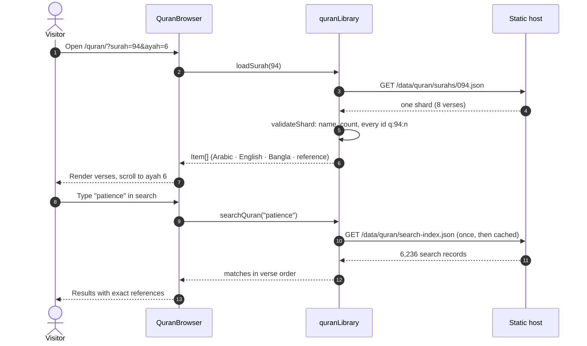

> [!NOTE]
> The search index may use a normalized copy of text for **matching only**. It is never displayed. The Arabic shown on screen is always the untouched frozen source.

---

## ⚙️ Everything is wired, and tested in a real browser

Every control below is exercised by an automated click-through that runs **under the production Content-Security-Policy**.

| Screen | What works |
| --- | --- |
| **Home** | *Get New Reminder* draws from all 6,236 verses (shuffle bag: no repeats in a pass, position survives reloads) · Save · Share Studio (copy text, download PNG, close) · *Open in the Qur'an reader* · *Read in context* · theme, scene and language toggles |
| **Qur'an** | 114 surahs · Previous/Next · 30-juz jump · go-to-ayah · continue reading · search (English, Bangla, names, `2:255`) · Save/Share on any verse · deep links |
| **Daily** | A verse for today, the same for everyone on the same local date, walking through the whole Qur'an · 7 catch-up days that open that verse · optional notifications |
| **Prayer times** | Live times, next prayer highlighted, *Use my location*, cached fallback offline |
| **Favorites** | Any verse · export JSON · import JSON (bad files rejected safely) · remove · share |
| **Settings** | Theme · 5 scenes · text size · reduce motion · languages · reminder source · city · calculation method · daily time · clear local data |
| **Footer / 404** | Muted autoplay film, every link resolves, poster under reduced motion |
| **Hadith / Categories** | An honest review gate with a working exit; see below |

### Listening, calm sounds, Bangla mode and share cards

| Feature | How it works |
| --- | --- |
| **Qur'an recitation** | *Listen* on any verse, or *Play surah*. Seven reciters, speed 0.75-1.5x, auto-continue into the next verse and surah, the current verse is highlighted and scrolled into view. Audio is streamed verse by verse from [EveryAyah](https://everyayah.com) (nothing is bundled). That host is the only addition to the CSP's `media-src`. Add a reciter by appending a row to `src/lib/audio/recitation.ts`. |
| **Calm sounds** | A floating mixer on every page: rain, wind, stream, ocean waves, morning birds and night crickets, each with its own volume, a master volume, four presets and a sleep timer. They are **synthesised on your device** with the Web Audio API, so there are no audio files, no licensing questions and no network use. Only natural sounds, no music. Your mix is remembered. |
| **Bangla mode** | *Settings → Interface language*: English, বাংলা, or both together ("Home · হোম"). It translates the app's own labels, never the scripture. Bangla text uses **Kalpurush** when it is available (see below), otherwise Noto Serif Bengali. |
| **Share Studio** | The card is now drawn on a canvas, so the preview is exactly the downloaded PNG (1080 px wide). Formats: Post, Story, Square. Templates: five built-in designs, the five scene photographs, and any pictures you add yourself. Actions: Download, Copy image, Share (where the browser supports it), Copy text, and direct links to WhatsApp, Telegram, X, Facebook and Email. |
| **Hadi** | "Want to read it more comfortably?" links to [Hadi](https://hadi-quran-guide.vercel.app/) on the home card, the reader and the footer. |

#### Two files only you can add

1. **Kalpurush font**: download `kalpurush.ttf` from a source you trust, check its licence, and place it at `public/fonts/kalpurush.ttf`. Nothing else changes; until then the fallback font is used.
2. **Your own card templates**: put licensed pictures in `public/share-templates/` and list them in `templates.json` (see the README in that folder). Good places: [Pexels](https://www.pexels.com/search/nature%20landscape/), [Unsplash](https://unsplash.com/s/photos/mountains) and [Pixabay](https://pixabay.com/images/search/landscape/), whose licences allow this kind of use. Keep the photographer's credit in the `credit` field.

### Why the buttons used to be dead

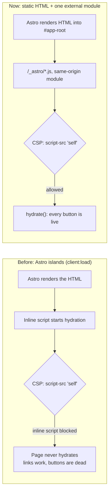

The site's strict CSP forbids inline scripts, but Astro islands start through inline scripts, so a production deploy rendered a page that looked right and did nothing. The dev server does not apply `_headers`, which is why it was missed. `AppRoot.astro` now renders the markup statically and hydrates it from a single bundled, same-origin script, so the strict CSP stays untouched. The first client render also starts from default settings so it matches the server HTML exactly.

### Reminders from the whole Qur'an

*Settings → Daily reminder → Where reminders come from* chooses the source:

- **The entire Qur'an** (default): random reminders and the daily verse cover all 6,236 verses. The daily verse is a pure function of the local date, so it is identical on every device, and it walks the Qur'an in order, so successive days are successive verses.
- **Only the owner-reviewed set**: the original two verses in `data/pools/reminder-pool.json`, which this code never modifies.

Each reminder offers *Open in the Qur'an reader* so a verse is never stranded out of context.

> [!IMPORTANT]
> Hadith and thematic categories are still gated. They are religious-content decisions: the project rules forbid generating them, and verified Bukhari/Muslim data has to be supplied and reviewed by a named person. The pages say so plainly instead of showing placeholder content.

---

## 🎨 Scene themes

Five scenes pair real photography with a matching palette. Each works with **dark and light** modes. Switch from **Settings → Scene** or the palette button in the header; your choice is remembered on your device.

<div align="center">
</div>

| Scene | Photograph | Photographer |
| --- | --- | --- |
| Emerald Mist | [Misty lake with lush greenery and fog-shrouded mountains](https://www.pexels.com/photo/misty-lake-with-lush-greenery-and-foggy-mountains-39757686/) | Sami TÜRK |
| Ink Mountains | [Misty mountains](https://www.pexels.com/photo/misty-mountains-10989215/) | Marina Solis |
| Lake at Dawn | [Mountain lake reflection at dawn](https://www.pexels.com/photo/serene-mountain-lake-reflection-at-dawn-29609552/) | eberhard grossgasteiger |
| Golden Dunes | [Golden Sahara desert dunes at sunset](https://www.pexels.com/photo/golden-sahara-desert-dunes-at-sunset-28829635/) | NaturEye Conservation |
| Crescent Night | [Crescent moon in a starry night sky](https://www.pexels.com/photo/crescent-moon-in-a-starry-night-sky-28849652/) | Cris Ménlés |

All photographs are from Pexels under the [Pexels License](https://www.pexels.com/license/) (free for commercial use, attribution not required, modification allowed). None shows people, buildings or text. The photos are decoration only and sit behind a palette veil so text always stays readable.

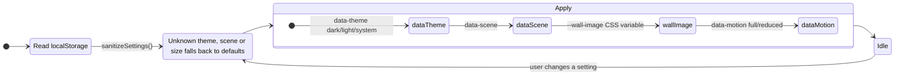

**Want the photos served from your own domain?** The app hot-links the Pexels CDN by default. Run `pnpm wallpapers:fetch` once (needs outbound internet): it downloads all ten files into `public/wallpapers/`, flips `WALLPAPER_SOURCE` to `'local'`, and then you can drop `https://images.pexels.com` from the Content-Security-Policy.

---

## 🎞 The footer film and the 404 page

The footer on every page, and the whole 404 page, sit on a looping, **muted** ink-wash film: misty mountains, a still lake and two cranes gliding across paper. It starts by itself, never plays sound, and pauses when scrolled out of view.

<div align="center">
</div>

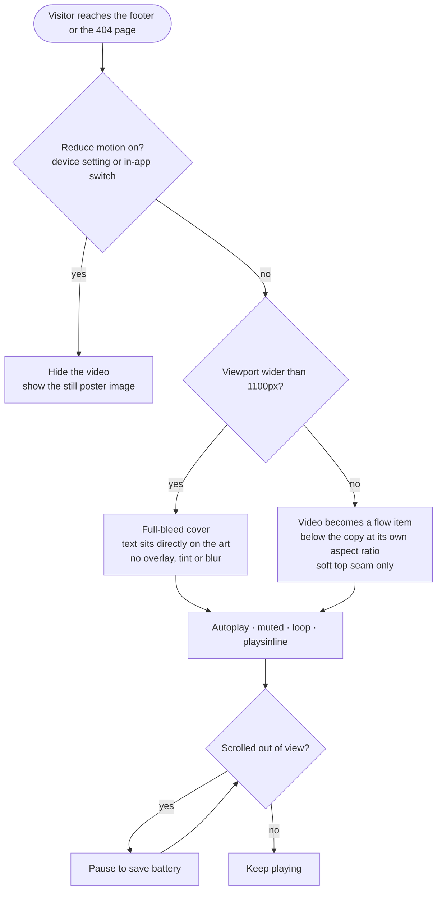

- The video and poster use the **exact URLs supplied by the project owner**; they are not downloaded or substituted (see `src/lib/media.ts`).
- The layout follows the owner's footer specification: five columns, five breakpoints, staggered entrance animations, and a reduced-motion fallback to the poster.
- The 404 page is a full-viewport stage with the animated logo, a clear message, two actions, and the same footer links.
- Required CSP additions (and nothing broader): `media-src` for the video host, `img-src` for the poster host and `images.pexels.com`. A test in `tests/unit/deployment.test.ts` locks this down and forbids `unsafe-inline`, `unsafe-eval` and wildcards.

---

## ✨ Animated logo and icons

<div align="center">

</div>

The mark is a mosque arch with a dome, two minarets and a guiding star. It **draws itself in once**, then the dome breathes softly and the star twinkles. It is pure CSS, costs no JavaScript, and is switched off under reduced motion (`LogoMark` in `src/components/Icon.tsx`, animation in `src/styles/global.css`).

Icons are **[Lucide](https://lucide.dev)** (ISC licence), the icon family used by most 21st.dev and shadcn components, inlined as path data so there is no runtime dependency and no network request. Closed shapes can opt into a **duotone** tint with `<Icon duo />`. The mosque glyph is our own, because Lucide has none.

> [!NOTE]
> The 21st.dev MCP itself could not be reached from the build environment, so no 21st.dev component code is vendored. If you want more of their components, connect it in your own Claude Code (`claude mcp add --transport http 21st https://21st.dev/api/mcp --header "x-api-key: <your key>"`). Keep the key outside the repository and rotate any key that has been pasted into a chat.

---

## 🧭 How the pieces fit together

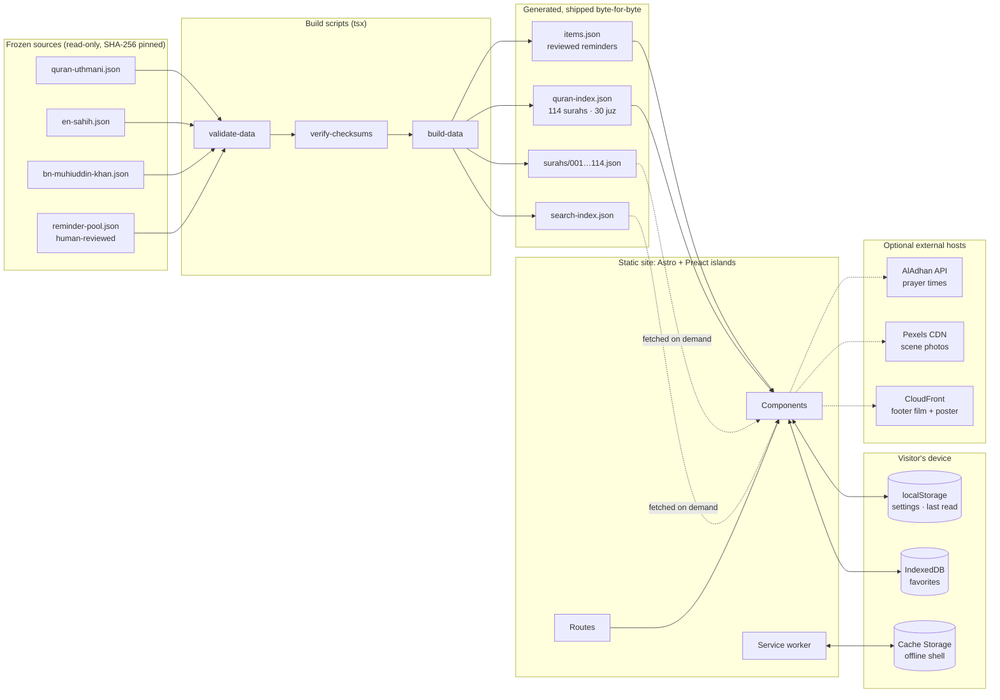

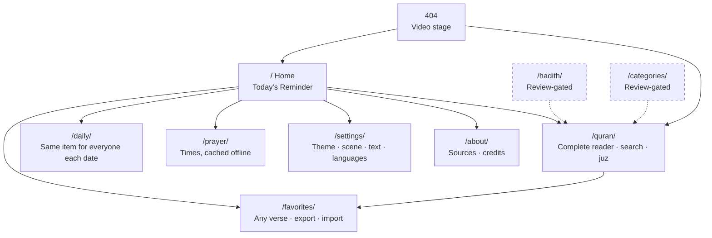

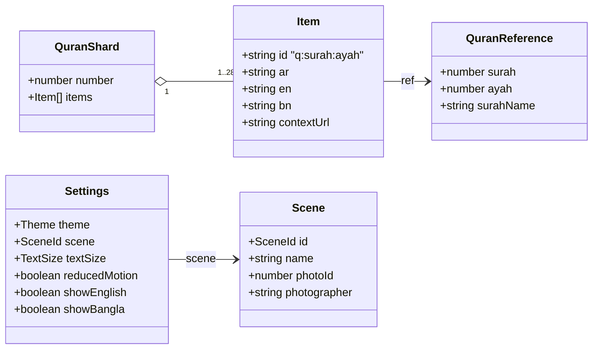

| Layer | Choice |
| --- | --- |
| Site | Astro (static output), TypeScript strict, Preact app hydrated from one external script |
| Motion and 3D | CSS first; GSAP and Three.js loaded lazily for the home hero only |
| Data | JSON generated from byte-pinned datasets; no database in V1 |
| Offline | Service worker with versioned caches (`al-hidayah-v3`) |
| Icons | Lucide, inlined (ISC) |
| Hosting | Static, on Vercel or Netlify (free tiers) |
| Quality | Vitest, Playwright, axe-core, ESLint, Prettier, `astro check` |
| Later (V2) | A secured Node.js API and MongoDB Atlas for reviewer workflows; see [`docs/04-v2-mongodb-plan.md`](docs/04-v2-mongodb-plan.md) |

---

## 🛡 How we keep the scripture correct

This is the part we will not rush. The full rules are in the [proposal, section 7](docs/01-project-proposal.md#7-content-integrity-the-most-important-section).

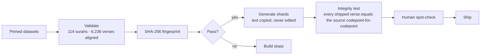

- The Arabic text is never edited by our code. It is fetched at a fixed version, checked against a reference copy, fingerprinted, and shipped byte for byte.
- The 114 surah shards are regenerated deterministically: adding navigation data (the juz index) left all 115 data files **byte-identical**.
- Reminders come from a **reviewed pool**, chosen by a qualified person, so a verse is never shown as a fragment out of context. Every item links to _read in context_.
- Hadith in Version 1 come only from Sahih al-Bukhari and Sahih Muslim, and only once reviewed.
- A build with a single failing check cannot be released.
- AI tools are used for code and design. They are never used to write, translate or tag religious content.
- If you find an error, please [open a content-error issue](../../issues/new/choose). It is treated as the highest-priority kind of report.

---

## 🗺 Where the project stands

**The full Qur'an application is implemented.** Hadith and thematic categories are deliberately empty until a qualified human reviewer supplies reviewed files; the app will not generate religious content to fill them.

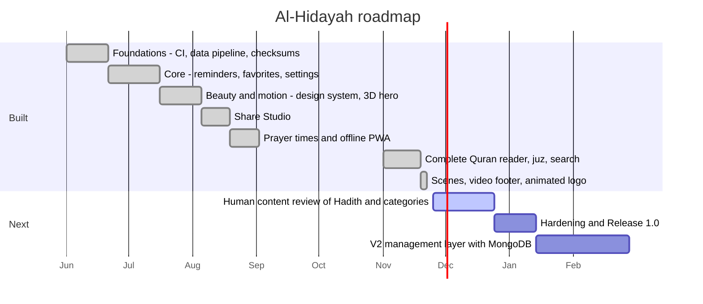

| Area | Status |
| --- | --- |
| Complete Qur'an (114 surahs, 6,236 verses) | ✅ Implemented, integrity-tested against the frozen sources |
| Search, juz, deep links, continue reading | ✅ Implemented |
| Favorites for any verse, Share Studio | ✅ Implemented |
| Scene themes, animated logo, Lucide icons, video footer, 404 | ✅ Implemented |
| Whole-Qur'an random and daily reminders | ✅ Implemented |
| Hydration under the strict CSP (every button live) | ✅ Fixed and covered by a test |
| Hadith (Bukhari and Muslim) | ⏳ Awaiting reviewed data and a named reviewer |
| Categories | ⏳ Awaiting reviewed files |
| Release 1.0 gates | ⏳ Human content review, cross-browser Share Studio exports, header scan, real-device footer check |

---

## 🚀 Running it locally

Requirements: Node.js 24 and pnpm 12.21.0 (`corepack pnpm …` works if `pnpm` is not on your PATH).

```bash
git clone https://github.com/mehedyk/Al-Hidayah.git
cd Al-Hidayah
pnpm install

pnpm data:validate   # all 114 surahs, 6,236 verses, and the reviewed pool
pnpm data:build      # regenerate site data without editing any text
pnpm data:verify     # compare every source with its committed SHA-256
pnpm dev             # http://localhost:4321
```

Optional: `pnpm wallpapers:fetch` to self-host the scene photos.

After `pnpm build`, run `pnpm preview` (or deploy) and check that the browser console shows **no** Content-Security-Policy errors on any page; that is the one thing a dev server cannot show you.

The frozen source responses are already committed. Do not use `data:fetch -- --pin` unless an intentional source update has a named reviewer.

<details>
<summary><b>Repository map</b></summary>

```text
src/
  components/    UI: reader, footer, header, settings, share studio
  lib/           data loading, settings, scenes, media, storage, picker
  styles/        global.css: tokens, scenes, footer film, animations
  pages/         index, [...route], 404
public/
  data/quran/    114 surah shards + search index
  icons/ images/ fonts/ sw.js manifest _headers
scripts/         data fetch · validate · build · verify · wallpapers
data/            frozen sources, reviewed pools, checksums, licenses
docs/            proposal, plan, design spec, v2 plan, assets (README figures)
tests/           unit · e2e · visual
```

</details>

---

## ✅ Testing and the release gate

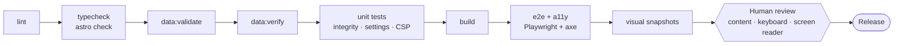

```bash
pnpm lint && pnpm typecheck
pnpm test            # unit: data integrity, reminders, settings, scenes, deployment headers
pnpm test:e2e        # hydration under CSP, reminders, reader, favorites, footer video, scenes, a11y
pnpm test:visual
pnpm build
pnpm release-gate    # the required static checks and production build
```

`pnpm release-gate` is not a substitute for human content review, manual keyboard and screen-reader checks, cross-browser Share Studio exports, or a deployment-header scan.

---

## 🌐 Deploying

The site is entirely static: no server adapter, database, secrets, or environment variables. Import the repository into Vercel or Netlify; the included configuration selects Node.js 24, pnpm 12.21.0, the verified build, and the `dist` output.

| Provider | Configuration | Build command | Output |
| --- | --- | --- | --- |
| Vercel | `vercel.json` | `pnpm build` | `dist` |
| Netlify | `netlify.toml` | `pnpm build` | `dist` |

Vercel applies headers from `vercel.json`; Netlify from `public/_headers`. A unit test keeps the two identical. Do not run `data:fetch` during deployment. After deploying, check the home page, a nested route, offline install, the footer film on a real phone, and the live response headers.

---

## 🔐 Security

- Static hosting, no accounts and no cookies in Version 1.
- Strict Content-Security-Policy: `script-src 'self'`, no inline script or style, and only three extra hosts, each for one purpose (scene photos, footer film, footer poster).
- HSTS, `nosniff`, a strict referrer policy and a locked-down permissions policy.
- Secrets live only in environment variables, never in the repository or the browser.
- The V2 reviewer dashboard design uses signed tokens, role checks on every protected route, least-privilege MongoDB credentials and an audit log.
- There are no payments and no donations.
- Please report vulnerabilities privately to the owner, not in a public issue.

---

## 🤝 Contributing, licenses and credits

1. Read [AGENTS.md](AGENTS.md). It applies to people as well as AI agents.
2. Keep pull requests small and focused.
3. Never change scripture data in a feature pull request. Data changes are separate, reviewed by a named person, and update the checksums on purpose.
4. Include tests, and say honestly what you did and did not check.

| | |
| --- | --- |
| **Code** | License to be chosen by the owner before the first release. Until then, all rights reserved. |
| **Scripture and translations** | Each dataset keeps its own license, credited in the app and in [`data/LICENSES.md`](data/LICENSES.md). Used unmodified and with attribution. |
| **Scene photography** | Pexels License; photographers credited above and on the About page. See [`docs/ASSETS.md`](docs/ASSETS.md). |
| **Footer film and poster** | Supplied by the project owner. |
| **Fonts** | SIL Open Font License, self-hosted. |
| **Prayer times** | AlAdhan API. |
| **Hero artwork** | Original AI-generated artwork for this project, with no writing or scripture. |

Thanks to everyone who maintains open Qur'an data. This project stands on their work.

---

## FAQ

**Is this a replacement for a scholar?**
No. It is a reminder tool. It offers no rulings. For questions of religion, ask a qualified teacher.

**Why is there no login?**
Because you do not need one. Favorites and your reading place stay on your device.

**Will you ever add ads or donations?**
No.

**Does the footer video play sound?**
Never. It is muted and loops silently. With "Reduce motion" on (or your device's setting) it is replaced by a still image.

**Why are Hadith and categories empty?**
They are religious-content decisions. They stay empty until a qualified reviewer supplies reviewed data, rather than being filled by software.

**Can you really stop people opening developer tools?**
No, and we say so openly. See the [proposal, section 8.7](docs/01-project-proposal.md#87-developer-tools-and-right-click-deterrent).

---

## বাংলায় সংক্ষেপে

**আল-হিদায়াহ** একটি ওয়েবসাইট, যেখানে কুরআনের সব সূরা ও ৬,২৩৬টি আয়াত আরবি, ইংরেজি ও বাংলা অনুবাদসহ নির্ভরযোগ্য সূত্র উল্লেখ করে পড়া যায়।

- প্রতিটি আয়াতের সঙ্গে থাকে সূরা ও আয়াত নম্বর।
- মূল আরবি পাঠ কখনও পরিবর্তন করা হয় না। যাচাই-প্রক্রিয়া পার না হলে কোনো সংস্করণ প্রকাশ হয় না।
- ৩০ পারা অনুযায়ী যাওয়া, আয়াত নম্বরে যাওয়া, সম্পূর্ণ কুরআনে অনুসন্ধান এবং শেষ পড়ার জায়গা থেকে আবার শুরু করা যায়।
- পছন্দের আয়াত নিজের ডিভাইসে সংরক্ষণ করা যায়, কোনো অ্যাকাউন্ট ছাড়াই।
- পাঁচটি দৃশ্য-থিম (বাস্তব ছবিসহ), নামাজের সময়সূচি এবং ছবি আকারে শেয়ার করার সুবিধা আছে।
- পুরো প্রকল্প বিনামূল্যে, কোনো বিজ্ঞাপন, ট্র্যাকিং বা অনুদান ছাড়া।

এটি একটি স্মরণ করানোর মাধ্যম। ধর্মীয় সিদ্ধান্তের জন্য অনুগ্রহ করে যোগ্য আলেমের শরণাপন্ন হোন।

---

<div align="center">


_Built with care. May it be of benefit._

</div>
