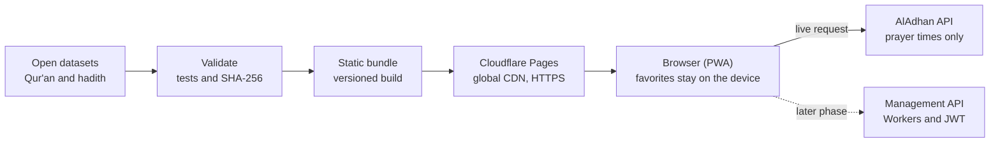
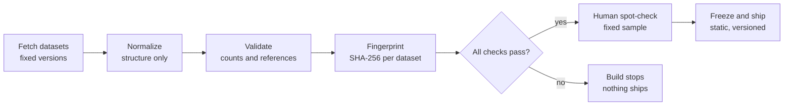
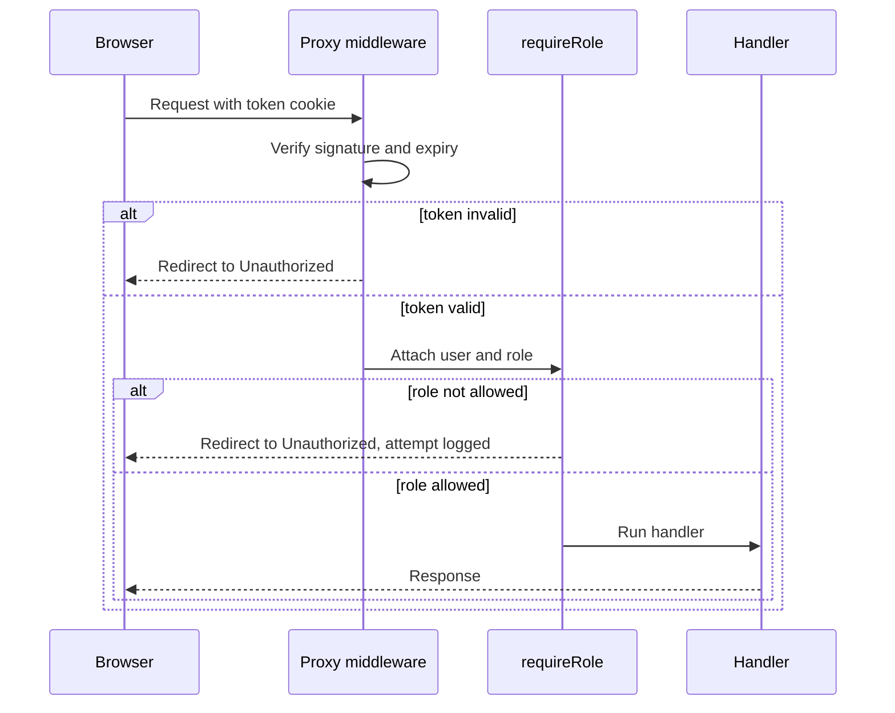

# Al-Hidayah: Project Proposal

*Quran · Hadith · Reminder*

**Document 1 of 5** · Version 1.1 · 1 November 2026 · Status: draft for approval

| # | Document | Purpose |
|---|---|---|
| 0 | `docs/pitch/al-hidayah-pitch.html` | Interactive deck that explains the ideas before this proposal is read |
| **1** | **Project Proposal** (this file) | What we will build, why, and under which rules |
| 2 | [Technical and Delivery Plan](02-technical-delivery-plan.md) | How we will build it, in what order |
| 3 | [Product and Design Specification](03-product-design-spec.md) | What every screen looks and behaves like |
| 4 | [AGENTS.md](../AGENTS.md) | The working agreement for AI agents that write code on this project |
| 5 | [README.md](../README.md) | The front door of the repository |

---

## 1. Executive summary

Al-Hidayah is a modern, desktop-first web application that places one verse of the Qur'an or one authentic hadith in front of a person each day, with the original Arabic, an English translation, a Bangla translation, and a precise reference. It is built to one standard: **the content must be correct, and the experience must be worthy of the content.**

It is built entirely on free, open tooling and free hosting. It ships as a fast static application. A small, tightly secured management layer is added in a later phase for review and administration.

| Item | Decision |
|---|---|
| Name | **Al-Hidayah** ("The Guidance") |
| Primary platform | Desktop web, fully responsive for tablet and mobile |
| Languages | Arabic (source text), English, Bangla |
| Budget | **$0**: free tiers and open-source software only |
| Architecture | Static-first (content bundled at build time) plus an optional serverless management layer |
| Visual identity | Dark emerald, gold, cream, with light and dark themes |
| Distinguishing features | Share Studio (post, story, send as message, raw image), 3D and scroll motion, offline-capable PWA |
| Payments or donations | **None**, by the owner's decision |

*Figure 1. The scripture is prepared and tested before anyone visits. At runtime the browser asks one outside service, for prayer times.*

---

## 2. Vision, mission and the problem

**Vision.** A few calm minutes each day, anchored in the Qur'an and the authentic Sunnah, for every Bangla- and English-speaking Muslim.

**Mission.** Deliver verified scripture in a clean, trustworthy, beautiful interface that is simple enough for a grandparent and good enough that people share it.

**The problem**

1. Most reminder apps are cluttered, ad-driven, or visually dated.
2. Many sources show translations without clear references, so readers cannot verify what they read.
3. Bangla and English beside the Arabic is rare in a polished experience.
4. Shared content on social media is usually a screenshot, which is low quality and often loses the reference.

**The opportunity.** Open datasets for the Qur'an, hadith and prayer times already exist and are free. The gap is *presentation, trust and shareability*, and that is where this project invests.

---

## 3. Audience

| Persona | Need | What Al-Hidayah gives them |
|---|---|---|
| The busy professional | One meaningful reminder in under a minute | A daily reminder that loads instantly and works offline |
| The student | Verify the source and compare translations | Arabic, English and Bangla together, with exact references |
| The elder | Large, calm, readable text | Adjustable text size, high contrast, no clutter |
| The sharer | Post something beautiful and correctly sourced | Share Studio with ready-made, accurate images |

---

## 4. Scope

### 4.1 In scope for Version 1

- Random Qur'an and hadith reminder with a "Get New Reminder" action
- Three-language display with a reference on every item
- Daily reminder: a deterministic "item of the day", the same for everyone on a given date
- Categories (for example patience, gratitude, family, repentance, knowledge)
- Favorites, stored on the user's device
- Prayer times, with the Karachi (University of Islamic Sciences) method as the Bangladesh default
- **Share Studio**, including **Send as message** (section 6)
- Light and dark themes, Bangla and English interface
- Offline support as a Progressive Web App
- Security hardening (section 8)

### 4.2 Later phases

- Management dashboard with role-based access (section 8.4)
- Direct one-tap buttons for WhatsApp and Messenger, beyond the device share sheet
- Audio recitation, tafsir links, Hijri calendar, Qibla direction

### 4.3 Out of scope

- Fatwa, legal rulings, or any original religious interpretation
- User-generated religious content
- Advertising, tracking, donations or payments of any kind

---

## 5. Feature overview

| Feature | Description | Priority |
|---|---|---|
| Random reminder | One verse or hadith, reshuffled on demand, never the same twice in a row | Must |
| Trilingual display | Arabic, English, Bangla, each in an appropriate typeface | Must |
| References | Surah and ayah, or collection, book and hadith number, plus grading for hadith | Must |
| Favorites | Save and revisit, on device, exportable | Must |
| Daily reminder | Item of the day, optional browser notification | Must |
| Categories | Browse by theme | Should |
| Prayer times | Based on location or a chosen city | Should |
| Share Studio | Branded image export and message sharing | Must |
| Motion and 3D | Scroll animation, parallax, a subtle 3D hero | Should |
| PWA | Installable and available offline | Should |

---

## 6. Share Studio

Sharing is how Al-Hidayah grows, so previews must be as polished as the app itself.

| Output | Typical canvas | Use |
|---|---|---|
| Social post (Facebook) | 1080 × 1350 (4:5) | Feed posts |
| Facebook story | 1080 × 1920 (9:16) | Stories |
| Instagram post | 1080 × 1350 (4:5) or 1080 × 1080 | Feed posts |
| Instagram story | 1080 × 1920 (9:16) | Stories |
| Raw image | Same artwork without extra frame, plus a plain-text copy option | Download |
| Send as message | Same artwork as the chosen format | Messenger, WhatsApp, Instagram Direct |

**Experience**

1. The user taps Share and a full-screen **live preview** shows exactly what will be exported.
2. They choose a format, a theme (emerald, midnight, cream) and which languages to include.
3. They tap Download, Share or Send.

**Send as message.** A Send button sits beside Download and Share. It opens the device share sheet with the image and a plain-text copy of the reference, so the person picks Messenger, WhatsApp, Instagram Direct or any installed messaging app and chooses the recipient there.

- It uses the browser's Web Share API with file support, which most phones offer; each browser is verified in Phase 3.
- Al-Hidayah cannot place a message into anyone's inbox by itself. Meta offers websites no public way to send a direct message for a user, so the final tap always happens inside the messaging app. This also keeps the feature free, with no extra permissions and no record of who receives what.
- Where file sharing is unavailable (most desktops), a fallback offers a WhatsApp link and a Messenger link carrying the text and reference, plus Download to attach the image by hand. Instagram has no equivalent web link, so desktop users download the image and attach it there.
- Every message carries the reference in the text and on the image.

**Correctness rules for every exported image**

- The Arabic text is rendered from the verified dataset, never retyped or edited.
- The reference is always printed on the image and cannot be turned off.
- A small Al-Hidayah mark is added and never overlaps the text.
- Text that does not fit is scaled down to a minimum size. If it still does not fit, the layout switches to a taller format instead of cutting the text.
- Arabic and Bangla shaping is tested on every build with golden-image comparisons.

> **Analogy.** Share Studio is a print shop with a proofreader. The customer chooses the paper size and style, but the proofreader refuses to print a page that drops a word or loses a citation.

---

## 7. Content integrity: the most important section

This is a religious project. A wrong letter, a missing diacritic, a misattributed hadith, or a mismatched translation is not a small bug. It can mislead people, and it would rightly anger them. Content integrity is therefore a **release-blocking requirement**, above visuals and above features.

### 7.1 Principles

1. **Never alter the source text.** No auto-correction, no trimming, no "cleaning" of Arabic.
2. **Every item shows its source.** Nothing is displayed without a verifiable reference.
3. **Hadith scope for Version 1: Sahih al-Bukhari and Sahih Muslim only.** This keeps grading disputes to a minimum. Other collections can follow with grading shown and scholarly review.
4. **No AI-generated religious content.** AI tools may help with code and design, never with scripture, translation, or categorization.
5. **A curated reminder pool.** A random pick from all 6,236 verses would sometimes surface a fragment, a legal ruling, or a verse whose meaning depends on its neighbours. The reminder pool is a reviewed subset, and every item links to "read in context".
6. **Human review for categories and the pool,** by a qualified person, before release.
7. **A visible way to report an error,** with a fast response process.
8. **Humility in the interface.** A short note states that Al-Hidayah is a reminder tool and does not replace scholars.

### 7.2 Sources

| Content | Primary source | Notes |
|---|---|---|
| Qur'an Arabic text | Tanzil (Uthmani) or Quran.com data | Use only under the source's terms; the text stays unmodified and credited |
| English translation | Selected open edition | Edition name shown in the interface |
| Bangla translation | Muhiuddin Khan edition via the open Quran API | Edition and license verified before release |
| Hadith | Open hadith-api (Bukhari, Muslim) | Includes numbering and grading; Bangla availability checked per edition |
| Prayer times | AlAdhan API | Karachi method as the Bangladesh default |

Full links are in the References section.

### 7.3 The verification pipeline

*Figure 2. A build ships only if every check passes.*

1. **Fetch** pinned versions of each dataset, never "latest".
2. **Normalize** only structure (for example field names), never text.
3. **Validate** automatically:
   - 114 surahs and 6,236 verses are present (standard Hafs count)
   - each surah has its expected number of verses
   - every item has Arabic, English, Bangla and a reference
   - every hadith has collection, book, number, and a grade of Sahih
   - no empty strings, stray control characters, or unexpected Unicode changes
4. **Fingerprint** each dataset with a SHA-256 checksum stored in the repository, so any accidental change fails the build.
5. **Spot-check** a fixed sample (for example 50 verses and 50 hadith) against a printed or trusted reference, by a human, at each release.
6. **Freeze and ship.** The build produces static files. Nothing is fetched from third parties at runtime except prayer times.

> **Analogy.** This is how a Mushaf is printed: many hands proofread before the press runs. The pipeline is the digital proofreader, and the checksum is the sealed wax stamp on the finished proof.

### 7.4 Testing for sensitive bugs

| Risk | Test |
|---|---|
| Arabic letters or diacritics lost or reordered | Byte-level comparison against the frozen dataset |
| Broken shaping on certain devices | Golden-image tests for Arabic and Bangla in several browsers |
| Wrong translation attached to a verse | Referential integrity test on every pair |
| Hadith missing its source | Build fails if any reference is missing |
| Share image cuts off text | Overflow test for the longest items in every format |
| Random picker repeats or fails | Statistical and unit tests for the shuffle |
| Offline mode serves stale or partial data | Service worker tests with versioned caches |

### 7.5 Release gate

No release is published unless all automated tests pass **and** a human has completed the spot-check checklist. Rollback is one click, because every build is a versioned static deployment.

---

## 8. Security proposal

### 8.1 Philosophy

The safest server is the one that does not exist. Version 1 serves static files and keeps user data on the user's own device, which removes most common attack classes (SQL injection, account takeover, session theft) by design. Where a backend is introduced later, it follows a strict, layered model.

> **Analogy.** A static site is a printed poster on a wall: anyone can read it, nobody can rewrite it from the street. A backend is a shop with a cash register: it needs guards, locks and rules.

### 8.2 Baseline hardening (Version 1)

| Control | Purpose |
|---|---|
| HTTPS everywhere, HSTS | Prevent downgrade and interception |
| Strict Content-Security-Policy | Block injected scripts |
| X-Content-Type-Options, Referrer-Policy, Permissions-Policy | Reduce browser-side leakage |
| `frame-ancestors` | Prevent clickjacking |
| Subresource Integrity for any third-party script | Detect tampering |
| Pinned, audited dependencies and automated updates | Reduce supply-chain risk |
| Cloudflare DDoS protection, basic WAF and bot protection | Absorb abuse |
| Turnstile on any form (for example error reports) | Stop automated spam |
| Strict input handling and output escaping | Prevent cross-site scripting |
| No analytics that fingerprint users | Privacy by default |

### 8.3 Secrets and configuration

- All API keys and secrets live in **environment variables** and platform secret stores, never in the repository and never in frontend code.
- Only values that are safe to be public reach the browser, and they are named explicitly as public.
- A pre-commit and CI secret scanner blocks accidental commits of keys.

> **Analogy.** Secrets belong in the safe, not taped to the front door.

### 8.4 Role-based access (management layer, later phase)

A small dashboard is planned for reviewers and administrators: error reports, category review, the daily-reminder calendar.

- **Roles:** Admin, Reviewer, Editor. A normal visitor has no role and no account.
- **A reusable `requireRole(...)` guard** protects every protected page and every protected API route.
- **Unauthorized access redirects** to a clear "Unauthorized" page. It never reveals whether a page exists.
- **A proxy middleware layer** runs before routes: it verifies the token, attaches the user and role, and rejects the request early if anything is wrong.
- **The backend is the authority.** Hiding a button is cosmetic; the server checks the role on every request.
- **JWT authentication:** short-lived access tokens, signed with a secret from the environment, delivered in secure, HttpOnly, SameSite cookies, with refresh rotation and logout revocation.
- **Rate limiting and lockout** on login, and audit logs for every privileged action.

> **Analogy.** Roles are hotel key cards: the card opens your floor and your room, not the manager's office. A JWT is the wristband at a concert: staff check it at every gate, and it expires at the end of the night.

### 8.5 Request flow for protected routes

### 8.6 Payments

Al-Hidayah has no payments and no donations, by the owner's decision. Should payments ever be reconsidered, **all payment API keys stay on the server**. The browser only receives a short-lived checkout session or link created by the server, and payment confirmations are verified server-side through signed webhooks. Card data never touches Al-Hidayah servers; the payment provider hosts it. This is not planned and would need its own proposal and security review.

### 8.7 Developer-tools and right-click deterrent

The request is to block right-click and common developer-tools shortcuts, and to show only a short *Salam* message if developer tools are opened. This is included, with an honest note.

**What it does**

- Disables the context menu on the app surface (outside text inputs).
- Intercepts common shortcuts such as F12, Ctrl+Shift+I, Ctrl+Shift+J, Ctrl+Shift+C and Ctrl+U.
- Detects an open developer panel and replaces the page with one calm line: **"Assalamu Alaikum."**

**What it cannot do.** A browser belongs to the user, and every client-side check can be bypassed (menu access, other browsers, disabled scripts, network inspection, or simply downloading the public files). It is a *"please do not enter" sign, not a lock*. Real protection comes from the server-side controls above, and scripture is public by nature.

**Safeguards so it does not anger genuine users**

- Never block text selection or copying of verses.
- Never activate on touch devices, and never interfere with screen readers or accessibility tools.
- Use conservative detection so a docked window or browser zoom never triggers it.
- Keep it behind a feature flag and active only in production, so developers are never locked out.
- Provide visible Share and Copy actions wherever the context menu would have been used.

---

## 9. Design direction

- **Palette.** Deep emerald backgrounds, warm gold accents, cream text and surfaces. The light theme uses cream surfaces with emerald and gold accents.
- **Typography (free, open-licensed).** A high-quality Arabic Naskh face for scripture, a refined serif for English headings, and a legible Bangla serif or sans for translation.
- **Motion.** Motion should feel like breathing, not flashing: slow fades, gentle parallax, one memorable 3D element in the hero. Every animation respects the reduced-motion setting.
- **3D.** Built with open-source Three.js. Spline's free plan adds a logo to web exports, so Spline is used for prototyping only.
- **Performance.** Fast first paint on mid-range phones. 3D loads lazily and falls back to a still image on weak devices.
- **Accessibility.** WCAG 2.2 AA contrast, keyboard navigation, correct language and direction attributes (RTL for Arabic), scalable text.
- **Desktop first.** The desktop layout is the hero experience, with the supplied mobile mockups guiding responsive behavior.

---

## 10. Free-tier budget

| Need | Choice | Cost |
|---|---|---|
| Hosting and CDN | Cloudflare Pages (unlimited bandwidth, 500 builds a month on the free plan) | $0 |
| DNS, SSL, DDoS, basic WAF, Turnstile | Cloudflare free | $0 |
| Optional backend | Cloudflare Workers (free daily request allowance) with free-tier storage | $0 |
| Prayer times | AlAdhan API (no key) | $0 |
| Source control and CI | GitHub and GitHub Actions free tier | $0 |
| 3D and motion | Three.js, GSAP (check current license), CSS animation | $0 |
| Fonts | Open-licensed (OFL) fonts, self-hosted | $0 |
| Domain | Free `*.pages.dev` address at launch; a custom domain is the only possible cost and is optional | $0 |

---

## 11. Risks and mitigations

| Risk | Impact | Mitigation |
|---|---|---|
| Text or translation error | Very high | Section 7 pipeline, checksums, human spot-check, release gate |
| Wrong hadith attribution or grade | Very high | Bukhari and Muslim only for v1, mandatory reference |
| A verse shown out of context | High | Curated reminder pool, "read in context" link on every item |
| Dataset license misunderstanding | High | Verify and record each license; credit sources in the app |
| Third-party API outage | Medium | Content is bundled; only prayer times are live, with cached fallback |
| Free-tier limit reached | Medium | Static hosting has no bandwidth cap; backend usage is monitored |
| Heavy animation slows low-end phones | Medium | Lazy loading, reduced-motion support, still-image fallback |
| Devtools deterrent annoys users | Medium | Safeguards in section 8.7 and a feature flag |
| Social images render incorrectly | Medium | Golden-image tests across browsers |
| Scope creep | Medium | Phased roadmap; v1 stays small and perfect |

---

## 12. Milestones (summary)

| Phase | Outcome |
|---|---|
| 0. Foundations | Repository, CI, data pipeline, validation tests |
| 1. Core experience | Reminder, three languages, references, favorites |
| 2. Beauty | Design system, motion, 3D hero, themes |
| 3. Share Studio | All formats, send as message, live preview, tests |
| 4. Prayer times and PWA | Location, offline mode |
| 5. Hardening and release | Security headers, penetration review, human content review, launch |
| 6. Management layer | Role-based dashboard, JWT, audit log |

The detailed plan, with dependencies and diagrams, is in [Document 2](02-technical-delivery-plan.md).

---

## 13. Success criteria

- Zero known content errors at release, verified by the release gate
- Largest Contentful Paint under 2.5 seconds on a mid-range phone over a typical connection
- Lighthouse scores of 95 or higher for Performance, Accessibility, Best Practices and SEO
- A security header grade of A or higher on a public scanner
- A first-time user can get, favorite and share a reminder in under 30 seconds
- Share images pass the golden-image tests in every supported format

---

## 14. Approval

By approving this proposal, the project owner confirms the name, scope, the content-integrity rules in section 7, the security model in section 8, and the free-only constraint. Open decisions before Document 2 is finalized:

1. Which English translation edition to feature by default.
2. Decided: no donations.
3. Who will perform the human content spot-check at each release.

---

## 15. References

1. Quran.com API documentation: https://api-docs.quran.com
2. AlQuran Cloud API: https://alquran.cloud/api
3. fawazahmed0 Quran API (includes the Muhiuddin Khan Bangla edition): https://github.com/fawazahmed0/quran-api
4. fawazahmed0 Hadith API (open, multilingual, graded): https://github.com/fawazahmed0/hadith-api
5. Tanzil Quran text and terms of use: https://tanzil.net/docs/
6. AlAdhan Prayer Times API and calculation methods: https://aladhan.com/prayer-times-api and https://aladhan.com/calculation-methods
7. Cloudflare Pages documentation and limits: https://developers.cloudflare.com/pages/
8. Cloudflare Turnstile: https://developers.cloudflare.com/turnstile/
9. OWASP Top 10: https://owasp.org/www-project-top-ten/
10. OWASP Application Security Verification Standard: https://owasp.org/www-project-application-security-verification-standard/
11. MDN, Content Security Policy: https://developer.mozilla.org/en-US/docs/Web/HTTP/CSP
12. RFC 7519, JSON Web Token: https://www.rfc-editor.org/rfc/rfc7519
13. MDN, Web Share API: https://developer.mozilla.org/en-US/docs/Web/API/Web_Share_API
14. W3C Web Content Accessibility Guidelines 2.2: https://www.w3.org/TR/WCAG22/
15. Three.js: https://threejs.org
16. GSAP licensing: https://gsap.com/licensing/
17. Spline pricing and plans: https://docs.spline.design/doc/pricing/docegJJLiZes
18. Google Fonts (Amiri, Noto Serif Bengali; Open Font License): https://fonts.google.com
