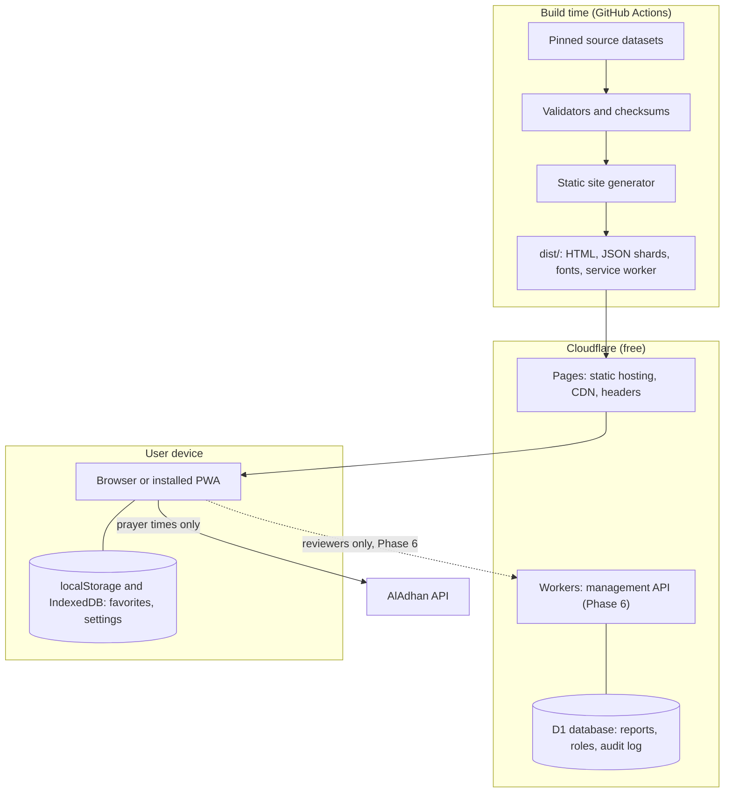
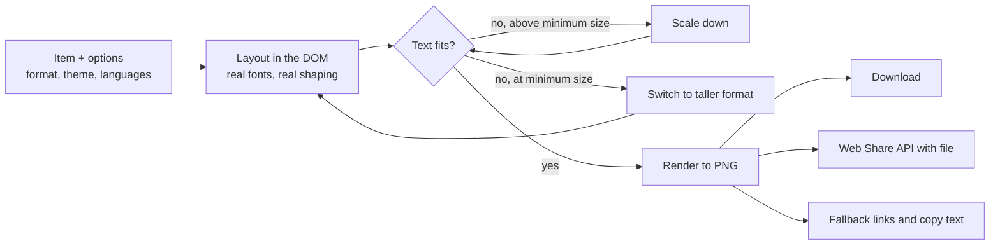
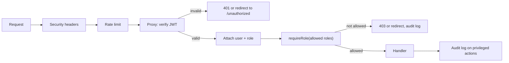
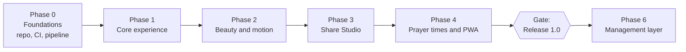

# Al-Hidayah: Technical and Delivery Plan

**Document 2 of 5** · Version 1.0 · 1 November 2026 · Status: draft for approval
Read after the [Project Proposal](01-project-proposal.md). Everything here serves the rules written there; where the two ever disagree, the proposal wins.

---

## 1. How to read this plan

This plan answers three questions in order: **what are we building it with and why** (sections 2 to 4), **how does each hard part work** (sections 5 to 11), and **in what order do we build and prove it** (sections 12 to 14).

Sizes use S, M and L instead of dates, because the project has no fixed team yet. S is a few focused working sessions, M is a couple of weeks of part-time work, L is longer. Convert them to calendar dates once the team is known.

Where this document says "verify", it means the fact came from public documentation that can change, and it must be re-checked on the day the work starts.

---

## 2. Principles that decide every technical choice

1. **Correctness before cleverness.** If a choice makes scripture harder to verify, we do not make it.
2. **Static first.** Anything that can be decided at build time is decided at build time.
3. **Free, and free forever.** No choice may depend on a paid plan, a trial, or a service that can start charging without notice.
4. **Boring where it matters, beautiful where it shows.** Proven tools for data, security and hosting; creative effort goes into design and motion.
5. **Everything reproducible.** The same commit must produce the same bytes.

---

## 3. Architecture



*Figure 1. Visitors only ever talk to the CDN and, for prayer times, to AlAdhan. The Worker and database exist only for the reviewer dashboard.*

**Analogy.** Think of a printing house with a bookshop. The content is printed, proofread and sealed in the printing house (the build). The bookshop (the CDN) hands out finished copies. Only the proofreaders' back office (the management API) has a door that needs a key.

---

## 4. Technology decisions

Every row names what we considered, because a choice without its alternatives is only an opinion. Pin exact versions on the day the repository is scaffolded.

| Concern | Decision | Why | Considered and set aside |
|---|---|---|---|
| Site framework | **Astro** with TypeScript | Ships almost no JavaScript by default, which suits a content-first site; interactive "islands" only where needed | Next.js static export (heavier runtime for a mostly static site), plain Vite (more hand-built routing) |
| UI islands | **Preact** or the framework Astro recommends at scaffold time | Small bundles for the reminder card, share studio and prayer widget | React (larger) |
| Styling | **CSS custom properties** plus a small utility layer | Design tokens map directly to the spec; dark and light themes are a variable swap | A large component kit (look would drift from the mockups) |
| Motion | **GSAP** with ScrollTrigger, and CSS for small effects | Best-in-class scroll choreography; verify the current license at gsap.com/licensing | Framer Motion (React-only), hand-rolled observers |
| 3D | **Three.js**, loaded lazily | Open source, no watermark, full control | Spline (free exports carry a logo; prototyping only) |
| Fonts | Self-hosted, Open Font License | No third-party requests, no privacy leak, predictable shaping | Google Fonts CDN at runtime |
| Data format | Sharded JSON | Small files, cacheable, offline-friendly | One large file, SQLite in the browser |
| PWA | **Workbox** or a hand-written service worker | Versioned caches, offline fallback | None |
| Image export | DOM rendered to PNG with a vetted open-source library, canvas fallback | The browser's own layout engine shapes Arabic and Bangla correctly | Pure canvas text layout (hard to get Arabic wrapping right) |
| Backend (Phase 6) | **Cloudflare Workers** with a small router and the `jose` library for JWT | Free tier, no servers | A hosted VPS (not free), serverless on another vendor |
| Database (Phase 6) | **Cloudflare D1** | Free tier, SQL, edge-local | External databases |
| Tests | Vitest, Playwright, axe-core, Lighthouse CI | Unit, visual, accessibility and performance coverage | None |
| Quality gates | ESLint, Prettier, TypeScript strict mode, gitleaks, dependency audit | Catches mistakes before review | None |
| Package manager | pnpm | Fast, strict, reproducible with a lockfile | npm, yarn |

**On "proxy middleware".** In a framework such as Next.js 16 the old `middleware` file is called `proxy`. We are not using Next.js, but the idea is the same and we keep the name: a function that runs before every protected route, verifies the token, attaches the user and role, and stops the request early if anything is wrong. In the Worker it is the first handler in the chain (section 10).

---

## 5. Repository layout

```text
al-hidayah/
├── README.md
├── AGENTS.md                      # working agreement for AI agents
├── docs/                          # these documents
├── data/
│   ├── sources/                   # pinned raw datasets (read-only)
│   ├── pools/                     # reviewed reminder pools and category tags
│   ├── checksums.json             # SHA-256 per dataset, committed
│   └── LICENSES.md                # license and attribution for every dataset
├── scripts/
│   ├── fetch-data.ts              # downloads exact pinned versions
│   ├── validate-data.ts           # structure, counts, references
│   ├── build-data.ts              # shards JSON for the site
│   └── verify-checksums.ts
├── src/
│   ├── pages/                     # routes
│   ├── components/                # reminder card, share studio, prayer widget
│   ├── lib/                       # picker, daily item, storage, share, theme
│   ├── styles/                    # tokens.css, themes, motion
│   ├── scenes/                    # Three.js hero (lazy)
│   ├── guards/                    # deterrent (devtools, context menu)
│   └── sw/                        # service worker
├── public/
│   ├── fonts/                     # self-hosted OFL fonts
│   ├── _headers                   # security headers for Cloudflare Pages
│   └── _redirects
├── worker/                        # management API (Phase 6)
│   ├── src/{index,middleware,auth,routes}/
│   └── migrations/
├── tests/
│   ├── data/                      # dataset integrity tests
│   ├── unit/
│   ├── e2e/
│   └── visual/                    # golden images for Arabic and Bangla
└── .github/
    ├── workflows/                 # ci.yml, deploy.yml, security.yml
    ├── ISSUE_TEMPLATE/
    └── pull_request_template.md
```

---

## 6. The data pipeline

This is the heart of the project and the part that must never be done quickly.

### 6.1 Record shapes

```ts
type Reference =
  | { kind: "quran"; surah: number; ayah: number; edition: { ar: string; en: string; bn: string } }
  | { kind: "hadith"; collection: "bukhari" | "muslim"; book: number; number: number;
      grade: "sahih"; edition: { ar: string; en: string; bn: string } };

interface Item {
  id: string;                 // "q:94:6", "h:bukhari:1"
  ref: Reference;
  ar: string;                 // never modified after fetch
  en: string;
  bn: string;
  categories: string[];       // from the reviewed pool file, not generated
  contextUrl: string;         // "read in context" link
}
```

### 6.2 Stages

| Stage | Command (planned) | What it guarantees |
|---|---|---|
| Fetch | `pnpm data:fetch` | Downloads exact pinned versions listed in `data/sources.lock.json`. Fails if a hash differs. |
| Validate | `pnpm data:validate` | Runs every check in section 6.3. Prints the first failure with the record id. |
| Build | `pnpm data:build` | Writes sharded JSON into `src/data/generated/`. Text is copied byte for byte. |
| Verify | `pnpm data:verify` | Recomputes SHA-256 and compares with `data/checksums.json`. |

### 6.3 Validation checks (all must pass)

- 114 surahs, 6,236 verses in the standard Hafs count, and the known verse count for each surah.
- Every verse has non-empty Arabic, English and Bangla.
- Arabic text compared to the Tanzil reference copy character for character, including diacritics and special Quranic marks.
- No unexpected Unicode normalization: the pipeline never runs NFC or NFD on Arabic.
- No control or zero-width characters except those present in the source and listed in an allow-list.
- Every hadith has collection, book, hadith number, an Arabic text, and a grade of Sahih.
- Every id in the reminder pool exists in the dataset, and every item in a category exists in the pool.
- No duplicate ids.

### 6.4 The reminder pool

The pool is a human-reviewed file: `data/pools/reminder-pool.json`, with category tags in `data/pools/categories.json`. An item enters the pool only when a qualified reviewer has marked it suitable as a standalone reminder. A pull request that edits the pool needs a named reviewer in its description, and the CI check refuses a pool change without it.

**Analogy.** The dataset is a library; the pool is the reading list a teacher chose for a first-time visitor.

---

## 7. Reminder logic

### 7.1 "Get New Reminder": the shuffle bag

Pure randomness repeats itself and feels broken. We use a **shuffle bag**: shuffle the pool once, deal items in order, and reshuffle only when the bag is empty. The first item of a new bag is never the last item of the previous one. The bag position is stored on the device so a refresh does not restart it.

**Analogy.** A deck of cards. You deal the whole deck before shuffling again, so no card shows up twice in a row.

### 7.2 "Daily reminder": the item of the day

The item of the day must be the same for everyone on the same date, with no server. We compute it from the date:

```ts
// Same pool, same date, same answer, on every device.
const dayNumber = Math.floor(Date.UTC(y, m - 1, d) / 86_400_000);
const index = permutedIndex(dayNumber, pool.length, SEED); // a fixed, documented permutation
const todayItem = pool[index];
```

- The date is taken in the user's local time zone, with Asia/Dhaka as the default before location is known.
- `permutedIndex` is a fixed algorithm with a fixed seed written down in `docs/`, so a future developer can reproduce any past day.
- The pool order is frozen per release, because changing it changes every future day. A change to the pool bumps a version and records the date it takes effect.

---

## 8. Share Studio, technically



*Figure 2. The renderer never cuts text. It scales, then changes format, then stops.*

- **Fonts first.** Wait for `document.fonts.ready` and for each face the card uses before rendering. Never render before the fonts load.
- **Why the DOM.** The browser already shapes Arabic and Bangla correctly and wraps lines correctly. Reusing it avoids rebuilding that logic on a canvas.
- **Known quirk.** Some browsers render the first export without images or fonts. The renderer does a warm-up pass and a second pass, and the visual tests include a first-export case. Verify per browser in Phase 3.
- **Sizes.** 1080 × 1350 for posts, 1080 × 1920 for stories, 1080 × 1080 as an optional square. Export at the pixel ratio that produces exactly those dimensions.
- **Send as message.** Use `navigator.canShare({ files })` to check support; if true call `navigator.share({ files, text })`. If not, show the fallback panel (copy text, WhatsApp link, Messenger link, Download). The panel explains in one sentence why Instagram needs the image attached by hand.
- **Text that travels with the image.** Reference, short link to the app, and nothing promotional beyond that.
- **Preview equals export.** The preview is the same DOM that is exported, scaled with CSS. There is no second layout that could drift.

---

## 9. PWA, offline and storage

| Concern | Decision |
|---|---|
| Install | Web app manifest with icons, theme colour, standalone display |
| Caching | App shell and data shards cached with a versioned cache name; old versions removed on activation |
| Updates | New version downloads in the background and applies on next launch; a small, polite "update ready" notice, never a forced reload mid-read |
| Offline | Reminder, favorites, categories and Share Studio work offline. Prayer times show the last known times, clearly labelled with the date they were fetched |
| Favorites | IndexedDB, keyed by item id; export and import as a plain JSON file so a user can move devices without an account |
| Settings | localStorage: theme, languages shown, text size, calculation method, city |
| Notifications | Optional, requested only after a clear explanation and a user action; the daily notification is scheduled in the service worker where the browser allows it |

**Privacy.** No accounts, no cookies in Version 1, no analytics that identify a person. If traffic numbers are wanted, use Cloudflare's privacy-friendly web analytics, which is free; verify its current data handling before enabling.

---

## 10. Security architecture

### 10.1 Headers (Cloudflare Pages `_headers`)

```text
/*
  Strict-Transport-Security: max-age=63072000; includeSubDomains; preload
  Content-Security-Policy: default-src 'self'; script-src 'self'; style-src 'self'; img-src 'self' data: blob:; font-src 'self'; connect-src 'self' https://api.aladhan.com; worker-src 'self'; manifest-src 'self'; object-src 'none'; base-uri 'self'; form-action 'self'; frame-ancestors 'none'
  X-Content-Type-Options: nosniff
  Referrer-Policy: strict-origin-when-cross-origin
  Permissions-Policy: geolocation=(self), camera=(), microphone=(), payment=()
  Cross-Origin-Opener-Policy: same-origin
```

Notes: the policy above assumes no inline scripts or styles. If the framework needs inline code, use hashes or nonces generated at build time, never `'unsafe-inline'` for scripts. Turnstile, when added, needs its challenge domain in `script-src`, `frame-src` and `connect-src`. Verify every directive in a scanner after each change. `geolocation=(self)` allows the site itself to ask for location for prayer times.

### 10.2 The deterrent module (`src/guards/`)

Spec, so it is built once and built carefully:

| Behaviour | Detail |
|---|---|
| Context menu | `contextmenu` is cancelled on the app surface only; allowed in inputs and text areas |
| Shortcuts | Cancel F12, Ctrl or Cmd with Shift+I, Shift+J, Shift+C, and Ctrl or Cmd+U. Never cancel Ctrl or Cmd+C, +A, +F, +P |
| Detection | Combine two weak signals (a large gap between inner and outer window size, and a timing check around a `debugger` statement). Act only when both agree twice in a row |
| Response | Replace the document body with a single centered line: **Assalamu Alaikum.** No explanation, no error text. Reloading with the panel closed restores the page |
| Never active | On touch devices, when `prefers-reduced-motion` or assistive technology hints are present, in development builds, or when the `deterrent` flag is off |
| Honesty | The code comment at the top states that this is a courtesy sign and not a security control, so no future developer mistakes it for one |

### 10.3 The management API (Phase 6)

**Identity.** Two options, decided at the start of Phase 6:

- **Option A (recommended): put the dashboard behind Cloudflare Access**, which is free for a small number of users (verify the current limit). Access signs in the reviewer and attaches a signed JWT to each request. The Worker verifies that JWT and maps the email to a role stored in D1. No password handling at all.
- **Option B: our own login** with email and password, JWT access tokens and rotating refresh tokens. This needs careful password hashing within the Worker's CPU limits (verify Argon2 or PBKDF2 options and the free-plan CPU time) and brings more responsibility.

**Middleware chain.** Every request passes through the same ordered steps:



```ts
// Illustrative, not final code.
export const requireRole = (...allowed: Role[]) => async (c: Context, next: Next) => {
  const user = c.get("user");                 // set by the proxy step
  if (!user || !allowed.includes(user.role)) {
    await audit(c, "denied", { path: c.req.path, role: user?.role ?? "none" });
    return c.redirect("/unauthorized", 302);  // never reveal whether the page exists
  }
  await next();
};

app.use("/admin/*", proxyVerifyJwt);
app.get("/admin/reports", requireRole("admin", "reviewer"), listReports);
app.post("/admin/pool", requireRole("admin"), updatePool);
```

**Permission matrix**

| Action | Admin | Reviewer | Editor | Visitor |
|---|---|---|---|---|
| Read public site | Yes | Yes | Yes | Yes |
| Submit an error report | Yes | Yes | Yes | Yes (with Turnstile) |
| View error reports | Yes | Yes | No | No |
| Mark a report resolved | Yes | Yes | No | No |
| Propose pool or category change | Yes | Yes | Yes | No |
| Approve pool or category change | Yes | Yes | No | No |
| Manage users and roles | Yes | No | No | No |
| View audit log | Yes | No | No | No |

**Secrets.** `JWT_SECRET`, any signing keys and any API keys are Worker secrets or environment variables. They are never in the repository, in `wrangler.toml`, or in client code. The `.env.example` file lists names only. A CI step fails the build if a secret pattern is found.

**Tokens.** Access token lifetime is short (minutes). Cookies are `HttpOnly`, `Secure`, `SameSite=Strict`. Refresh tokens rotate on every use and are stored hashed; a reused refresh token revokes the whole session family.

**Analogy.** The security headers are the walls and the fence. The proxy is the guard at the gate checking your wristband. `requireRole` is the usher who knows which doors your wristband opens.

---

## 11. Quality: how we test what cannot be wrong

| Layer | Tool | What it proves |
|---|---|---|
| Data integrity | Vitest | Everything in section 6.3, on every commit |
| Checksums | Script in CI | The shipped text is byte-identical to the reviewed text |
| Unit | Vitest | Shuffle bag, daily permutation, storage, share fallbacks |
| Visual | Playwright screenshots | Golden images of reminder cards and every share format, in Arabic, English and Bangla, in at least Chromium, Firefox and WebKit |
| Accessibility | axe-core in Playwright | No critical violations on any route |
| Performance | Lighthouse CI | Scores and budgets in section 13 |
| Security | gitleaks, dependency audit, header scan | No secrets, no known-vulnerable packages, headers as specified |
| Manual | Spot-check checklist | A human compares a fixed sample with a trusted printed or published copy |

**The release gate** is a single required status check named `release-gate` that is green only when every row above passes and a maintainer has ticked the manual checklist in the release pull request.

---

## 12. Delivery roadmap



| Phase | Size | Outcome | Exit gate |
|---|---|---|---|
| 0. Foundations | M | Repo, CI, lint, type-check, secret scanning, pinned dataset fetch, validators, checksums, license file | `pnpm data:validate` and `pnpm data:verify` green in CI; every dataset license recorded |
| 1. Core experience | L | Reminder card with three languages and references, shuffle bag, daily item, categories, favorites, themes, basic responsive layout | A reviewer can read 50 random items and find no error; keyboard-only use works |
| 2. Beauty and motion | L | Full design system, home page per mockups, scroll choreography, lazy 3D hero with still-image fallback, reduced-motion support | Visual match to mockups signed off; budgets in section 13 met |
| 3. Share Studio | M | Live preview, all formats, send as message with fallbacks, golden-image tests | Every format passes visual tests in three engines on the longest items |
| 4. Prayer times and PWA | M | Location and city selection, Karachi default, cached fallback, installable, offline | Airplane-mode test passes; times match a trusted local timetable |
| 5. Hardening and release | M | Headers, scanner grade, penetration checklist, accessibility audit, human content review, launch | `release-gate` green; scanner grade A or better; reviewer sign-off recorded |
| 6. Management layer | L | Dashboard, roles, JWT or Access, audit log, error-report intake | Every protected route denied for every wrong role in automated tests |

Phases 0 to 5 produce Release 1.0. Phase 6 is separate so that the public site is never held up by the admin tools.

### Dependencies worth noticing

- Phase 1 cannot start until the dataset licenses and the reminder pool process are settled, because they decide what the cards can show.
- Phase 3 depends on Phase 2's tokens and fonts; building the share layouts earlier means building them twice.
- The deterrent module (section 10.2) is built in Phase 5, after the interface is stable, so that it is tested against the real thing.

---

## 13. Budgets and targets

These are targets to be measured, not promises. Adjust with data, never silently.

| Metric | Target |
|---|---|
| Largest Contentful Paint (mid-range phone, typical connection) | under 2.5 s |
| Cumulative Layout Shift | under 0.1 |
| Interaction latency | under 200 ms |
| JavaScript on the critical path | as small as the framework allows; track it in CI and fail on growth above an agreed limit |
| 3D hero | loads after first paint, on capable devices only, with a still-image fallback |
| Lighthouse | 95 or higher in all four categories |
| Accessibility | WCAG 2.2 AA, zero critical axe violations |
| Offline | Reminder, favorites and Share Studio work with no connection |

---

## 14. Environments and operations

| Environment | Purpose | How it deploys |
|---|---|---|
| Local | Development | `pnpm dev` |
| Preview | One per pull request | Cloudflare Pages preview URL, created automatically |
| Production | The public site | Merge to `main` after `release-gate` is green |

- **Rollback:** redeploy the previous build from the Pages dashboard; builds are immutable.
- **Dependencies:** automated update pull requests, merged only with green checks. Pin exact versions. Review any new dependency for license, maintenance and size before it enters.
- **Error reports:** in Version 1 an error report is a prefilled link to a GitHub issue form, so there is a human-readable trail before any backend exists.
- **Incident rule:** if a content error is reported, the first action is to remove the affected item from the pool and redeploy. Investigation follows, not before.

---

## 15. Open technical questions

1. Which English translation edition is the default, and what are its license terms?
2. Does the chosen Bangla edition cover every hadith in the pool, or do some items need to be excluded?
3. Cloudflare Access (Option A) or a custom login (Option B) for Phase 6?
4. Who is the qualified reviewer for the reminder pool and categories?
5. Will a custom domain be bought, or does launch use the free `pages.dev` address?

---

## 16. References

1. Astro documentation: https://docs.astro.build
2. Cloudflare Pages headers: https://developers.cloudflare.com/pages/configuration/headers/
3. Cloudflare Workers limits: https://developers.cloudflare.com/workers/platform/limits/
4. Cloudflare D1: https://developers.cloudflare.com/d1/
5. Cloudflare Access: https://developers.cloudflare.com/cloudflare-one/policies/access/
6. `jose` JWT library: https://github.com/panva/jose
7. OWASP Cheat Sheet Series (Authentication, Password Storage, Session Management, JWT): https://cheatsheetseries.owasp.org
8. MDN, Content Security Policy: https://developer.mozilla.org/en-US/docs/Web/HTTP/CSP
9. MDN, Web Share API and `navigator.canShare`: https://developer.mozilla.org/en-US/docs/Web/API/Navigator/canShare
10. Workbox: https://developer.chrome.com/docs/workbox
11. Playwright: https://playwright.dev
12. axe-core: https://github.com/dequelabs/axe-core
13. Lighthouse CI: https://github.com/GoogleChrome/lighthouse-ci
14. gitleaks: https://github.com/gitleaks/gitleaks
15. Tanzil downloads and license: https://tanzil.net/download/
16. fawazahmed0 hadith-api: https://github.com/fawazahmed0/hadith-api
17. AlAdhan API documentation: https://aladhan.com/prayer-times-api
