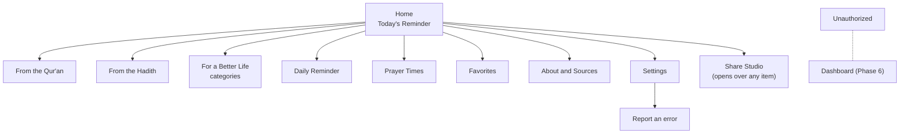

# Al-Hidayah: Product and Design Specification

**Document 3 of 5** · Version 1.0 · 1 November 2026 · Status: draft for approval
Read after the [Project Proposal](01-project-proposal.md) and the [Technical Plan](02-technical-delivery-plan.md). This document describes what a person sees, touches and hears (there is no sound), screen by screen.

The supplied mockups are the visual source of truth: a mobile home screen and a desktop home screen in deep emerald with a gold-lit mosque at dusk, a figure seated on a hilltop, the verse "Indeed, with hardship comes ease." (94:6) in Arabic, English and Bangla, a primary "Get New Reminder" button, a secondary "Save" button, and four entry cards. Where this document and a mockup disagree, ask the owner; do not guess.

---

## 1. Design intent

Al-Hidayah should feel like walking into a quiet mosque courtyard at the end of the day: unhurried, warm, a little awe, nothing shouting. The interface exists to get out of the way of the words.

Five principles decide every detail:

1. **The text is the hero.** Scripture is always the largest, calmest, best-set thing on screen.
2. **Reverent restraint.** Beauty is allowed; showiness is not. No confetti, no bounce, no sound, no emoji near scripture.
3. **Usable by anyone.** A grandmother with large text and a teenager with a phone both succeed on the first try.
4. **One memorable moment per page.** A single orchestrated effect (the hero), with everything else quiet.
5. **Never lose a word.** Layouts adapt to the text. The text never adapts to the layout.

---

## 2. Design tokens

The values below are starting points read by eye from the mockups. Replace them with exact values using an eyedropper on the source files, then freeze them in `src/styles/tokens.css`.

### 2.1 Colour

| Token | Dark theme | Light theme | Use |
|---|---|---|---|
| `--bg` | `#08241D` (deep emerald) | `#F6EEDB` (cream) | Page background |
| `--bg-raised` | `#0E3329` | `#FFFFFF` at 70% over cream | Cards and panels |
| `--bg-glass` | emerald at 55% with blur | cream at 70% with blur | Floating bars, translucent panels |
| `--text` | `#F3EAD3` (cream) | `#10241E` (near-black emerald) | Primary text |
| `--text-quiet` | `#B9C7BE` | `#4A5E55` | Secondary text |
| `--gold` | `#E2B857` | `#9A7420` | Accents, primary button, ornaments |
| `--gold-soft` | `#E2B857` at 18% | `#9A7420` at 14% | Fills behind gold elements |
| `--line` | gold at 28% | emerald at 20% | Dividers, borders |
| `--focus` | `#FFE08A` | `#0B5D49` | Keyboard focus ring |
| `--danger` | `#E58A7B` | `#A5352A` | Errors |

Contrast rule: body text must reach at least 4.5:1 and large text 3:1 on its real background, including over photography. Where text sits on an image, a scrim sits between them, and the tests check the result.

### 2.2 Typography

| Role | Typeface (all Open Font License, self-hosted) | Notes |
|---|---|---|
| Qur'anic Arabic | **Amiri Quran** | Designed for the full set of Quranic marks; verify every mark in the dataset renders |
| Hadith Arabic | **Amiri** | Same family, calmer for prose |
| English headings | A refined old-style serif such as **Cormorant Garamond** or **EB Garamond** | Matches the "Today's Reminder" style in the mockups |
| English body and UI | A clean humanist sans such as **Inter** | |
| Bangla | **Noto Serif Bengali** for translation, **Hind Siliguri** or **Noto Sans Bengali** for UI | Test conjuncts (যুক্তাক্ষর) at every size |

Scale (desktop; scale down by one step on tablet and two on mobile):

| Style | Size | Line height | Notes |
|---|---|---|---|
| Arabic hero | 56 to 72 px | 2.0 | Generous line height protects stacked diacritics |
| English hero translation | 32 to 40 px | 1.35 | Italic serif as in the mockup |
| Bangla translation | 22 to 26 px | 1.8 | Bangla needs more air than Latin |
| Heading 2 | 32 px | 1.2 | |
| Body | 18 px | 1.6 | Minimum 16 px anywhere |
| Caption and reference | 15 px | 1.4 | |

Rules: never letter-space Arabic or Bangla; never set Arabic in italics or bold; keep line length under about 70 characters for English and Bangla; give users a text-size control (small, default, large, extra large) that scales everything proportionally.

### 2.3 Space, shape, elevation

- 8-point spacing scale (4, 8, 16, 24, 32, 48, 64, 96).
- Corner radius: 12 px for cards, 999 px for pills (primary and secondary buttons, as in the mockups), 8 px for small controls.
- Elevation is expressed by blur and a hairline gold border, not by heavy drop shadows.
- Ornament: a thin gold divider with a small arch motif above "Today's Reminder", and a faint geometric lattice in the lower-left corner as in the desktop mockup. Ornament is decoration only and never carries information.

---

## 3. Information architecture



Primary navigation (desktop top bar, as in the mockup): **Home, About, Favorites, Settings**, with a sun and moon theme toggle at the right. On mobile the same four items form the bottom tab bar. Prayer Times appears as a compact strip on Home and as its own page. The four entry cards on Home map to: From the Qur'an, From the Hadith, For a Better Life, Daily Reminder.

---

## 4. Screens

Each screen lists its purpose, content, states and behaviour.

### 4.1 Home (desktop, the hero experience)

**Purpose.** Give one reminder, instantly, and make the next step obvious.

**Layout (1440 px wide, from the mockup)**

```text
┌────────────────────────────────────────────────────────────────────────────┐
│ [logo] Al-Hidayah    ( Home )  About  Favorites  Settings          ☀ | ☾  │
│        Quran·Hadith·Reminder                                               │
├────────────────────────────────────────────────────────────────────────────┤
│                       ── ornament ──                                       │
│                      Today's Reminder                                      │
│                  إِنَّ مَعَ الْعُسْرِ يُسْرًا                  (hero scene:│
│              "Indeed, with hardship comes ease."          figure, mosque,│
│                       — Qur'an, 94:6 —                      dusk, 3D layer)│
│             ┌ নিশ্চয় কষ্টের সাথে রয়েছে সহজতা। ┐                           │
│             [ ⟳ Get New Reminder ]  |  [ ♡ Save ]    (+ Share)             │
│  ┌──────────────┬──────────────┬──────────────┬──────────────┐             │
│  │ From Qur'an  │ From Hadith  │ Better Life  │ Daily        │             │
│  └──────────────┴──────────────┴──────────────┴──────────────┘             │
│                         ⌄ Scroll Down                  Powered by Faith ♡  │
└────────────────────────────────────────────────────────────────────────────┘
```

**Content of the reminder block**

- Arabic text, centered, largest.
- English translation in italic serif with a clear quotation treatment.
- Reference line: surah name and number with ayah, or collection, book and hadith number with grade.
- Bangla translation inside a softly glassed pill, with its own reference.
- A discreet "Read in context" text link.
- Three actions: **Get New Reminder** (primary, gold pill), **Save** (outlined pill with heart), **Share** (icon button). All three have visible labels, not icons alone.

**States**

| State | What the person sees |
|---|---|
| First load | The daily item is shown. A short line says "Today's reminder" and the date. |
| After "Get New Reminder" | The card cross-fades to the next item in the shuffle bag. Focus returns to the reminder heading and a polite live region announces the new reference for screen readers. |
| Saved | The heart fills with gold; the label changes to "Saved"; a small, silent confirmation appears and fades. Activating again removes it. |
| Offline | The reminder still works. A quiet line says "You are offline. Prayer times may be out of date." |
| Data error (should never happen) | The item is replaced by a calm message and the failure is reported to the build log; scripture is never shown if any part of it failed to load. |
| Loading | A skeleton in the exact shape of the card. No spinner over scripture. |

**Hero behaviour.** The background image or 3D scene sits behind a scrim. It is decorative. See section 7 for the motion spec.

**"Scroll down" content** (below the hero, in this order): a short "How Al-Hidayah works" panel (what the reminder is, where the text comes from); the four entry cards expanded; the prayer-times strip; a "Sources and integrity" panel with the edition names and a link to report an error; the footer.

### 4.2 Home (mobile)

From the supplied mobile mockup: the same blocks in one column. Header with logo and a settings icon; reminder card with Arabic, English, Bangla; **Get New Reminder** and **Save** side by side; a two-by-two grid of the entry cards; a closing quote above a bottom tab bar (Home, About, Favorites, Settings) with the active tab in a gold-tinted pill. The tab bar respects the phone's safe area. Tap targets are at least 44 × 44 px.

### 4.3 Qur'an and Hadith browsers ("From the Qur'an", "From the Hadith")

- A calm list of reminder-pool items, one per row: Arabic first line, English first line, reference, a heart.
- Filter by category with pill chips; search by keyword inside translations only (never rewrites text).
- Selecting an item opens the same reminder card used on Home, with Share and Save.
- Pagination or "load more", never infinite scroll that hides the footer.

### 4.4 For a Better Life (categories)

A grid of category tiles (patience, gratitude, family, repentance, knowledge and others the reviewer approves). Each tile shows the category name in English and Bangla and the number of items. Tiles are illustrated with the shared ornament set, not stock photography. A category page lists its items as in 4.3.

### 4.5 Daily Reminder

- Shows today's item with the Hijri and Gregorian dates.
- A switch: "Remind me daily" with a time picker. Pressing it explains in one sentence what will happen, then requests browser permission. If permission is denied, the screen says so plainly and shows how to enable it in browser settings. It never asks twice in the same session.
- A "Yesterday and the days before" list for catching up.

### 4.6 Prayer Times

- Location by browser permission or by choosing a city; Dhaka is the default. The calculation method defaults to Karachi (University of Islamic Sciences) and can be changed in Settings.
- Shows Fajr, Sunrise, Dhuhr, Asr, Maghrib, Isha with the next prayer highlighted and a countdown. Times are labelled with the city and the date fetched.
- If the live request fails, the last known times are shown with their date. If there are none, a calm message explains and offers a retry.
- Privacy line: location is used only to ask for prayer times and is never stored on a server.

### 4.7 Favorites

- A list of saved items with Arabic, English, Bangla and reference, newest first.
- Remove, Share, and "Export favorites" (a JSON file) and "Import favorites".
- Empty state: "Nothing saved yet. Press Save on any reminder and it will appear here." with a link back to Home.
- A one-line note: favorites are stored on this device only.

### 4.8 About and Sources

Who it is for, the purpose, the sources with edition names and licences, the Hadith scope (Sahih al-Bukhari and Sahih Muslim), the note that this tool does not replace scholars, a link to report an error, and credits.

### 4.9 Settings

| Setting | Options |
|---|---|
| Theme | Dark, Light, Match device |
| Languages shown | Arabic always on; English and Bangla each on or off |
| Interface language | English or Bangla |
| Text size | Small, Default, Large, Extra large |
| Motion | Full, Reduced (also follows the device setting) |
| Prayer calculation method and city | List with Karachi as default |
| Daily reminder | Time and on/off |
| Data | Export favorites, import favorites, clear local data |
| Report an error | Opens the report form |

### 4.10 Share Studio

**Entry.** A Share button on any reminder opens a full-screen sheet on mobile and a large centered dialog on desktop.

**Layout (desktop)**

```text
┌──────────────────────────────────────────────────────────────┐
│ Share this reminder                                      ✕   │
├──────────────────────────────┬───────────────────────────────┤
│                              │ Format                        │
│      LIVE PREVIEW            │ (•) Post 4:5   ( ) Story 9:16 │
│      (exact export,          │ ( ) Square 1:1                │
│       scaled to fit)         │ Theme                         │
│                              │ [Emerald] [Midnight] [Cream]  │
│                              │ Languages                     │
│                              │ [x] Arabic [x] English [ ] বাংলা │
│                              │                               │
│                              │ [ Download image ]            │
│                              │ [ Share ]  [ Send as message ]│
│                              │ [ Copy text ]                 │
└──────────────────────────────┴───────────────────────────────┘
```

**Behaviour**

- The preview updates instantly as options change. It is the same DOM that is exported.
- Format names match the platforms people look for: "Facebook post", "Facebook story", "Instagram post", "Instagram story", "Image only". They share three real shapes (4:5, 9:16, 1:1) and the preview shows each platform's safe zone where the platform overlays its own buttons (for stories, the top and bottom bands).
- **Download image** saves a PNG. **Share** opens the device share sheet. **Send as message** opens the device share sheet with the image and text so the person picks Messenger, WhatsApp or Instagram Direct. If the browser cannot share files, the panel changes to Copy text, WhatsApp link, Messenger link and Download, with one sentence explaining that Instagram needs the image attached by hand.
- **Copy text** copies Arabic, translations and reference as plain text with the reference line always included.
- On success, a short plain confirmation: "Image saved." or "Ready to send." On failure: what happened and what to do next.

**Share artwork rules**

- The artwork is calm and uncluttered: ornamental border, the verse, the translations selected, the reference, a small Al-Hidayah mark at the foot.
- Three themes: Emerald (as the app), Midnight (deeper, near-black green), Cream (light, printable).
- The reference is mandatory and cannot be removed. The mark never overlaps text.
- Typographic sizes follow section 2.2 and shrink in steps to a minimum. If the text still does not fit, the layout moves to a taller format and tells the person why.
- No emoji, no stickers, no background photographs of people, no music.

### 4.11 Report an error

A short form: which item (pre-filled), what looks wrong, optional contact. It is protected by Turnstile when a backend exists; in Version 1 it opens a prefilled issue form. After submitting: "Thank you. A reviewer will check this."

### 4.12 Unauthorized, Not found, and the Salam screen

- **Unauthorized** (Phase 6): "You don't have access to this page." One button: "Return to the home page." It reveals nothing about what the page is.
- **Not found:** "This page doesn't exist." with a link home and a search field.
- **Salam screen:** a plain page with one centered line, **Assalamu Alaikum.**, in the Arabic and English typefaces on the page background. Nothing else. See the technical plan for when it appears.

---

## 5. Voice and content rules

Tone: warm, plain and respectful. Short sentences. Sentence case. Verbs that say what will happen.

| Do | Do not |
|---|---|
| "Get New Reminder", "Save", "Share" | "Click here", "Submit", "Awesome!" |
| Use ﷺ after the Prophet's name in Arabic and Bangla contexts, and "peace be upon him" or ﷺ in English | Abbreviate honorifics to "pbuh" in the interface |
| Name sources fully and consistently | Say "from the Hadith" with no collection and number |
| Say what went wrong and what to do | Apologize vaguely or use jokes in errors |
| Show the Arabic exactly as in the dataset | Retype, trim, or "tidy" scripture anywhere, including in design files |

Bangla interface copy is written by a fluent Bangla writer and reviewed by a second person. Machine-generated Bangla UI copy is not shipped. Religious terms follow common usage in Bangladesh (for example নামাজ, আল্লাহ, রাসুলুল্লাহ ﷺ) and the owner decides spelling conventions once, in a glossary file.

---

## 6. Accessibility

| Area | Requirement |
|---|---|
| Standard | WCAG 2.2 level AA throughout |
| Language and direction | `lang="ar" dir="rtl"` on Arabic blocks, `lang="bn"` on Bangla, `lang="en"` on English, on the element that holds the text |
| Keyboard | Every action reachable and operable; visible focus ring using `--focus`; logical order; a skip link to the reminder |
| Screen readers | The reminder is a labelled region; "Get New Reminder" announces the new reference via a polite live region; icon buttons have text names |
| Motion | `prefers-reduced-motion` removes parallax and 3D movement and shortens fades; a Settings switch does the same |
| Targets | At least 44 × 44 px touch targets |
| Zoom and text size | Layout holds at 200% zoom and with the largest text size; no horizontal scroll |
| Colour | Never the only carrier of meaning; contrast per section 2.1 |
| Images | Decorative art is hidden from assistive technology; share previews have text equivalents |

---

## 7. Motion and 3D specification

Motion is allowed to feel like breathing, never like performing.

### 7.1 The one memorable moment

On first load of Home, the hero plays a single orchestrated sequence of about three seconds: the dusk scene fades up, a gold line draws the arch ornament above "Today's Reminder", and the Arabic text appears word by word from right to left in the order it is read. After that, the page is still except for a slow ambient drift in the background. The sequence plays once per session and is skipped entirely under reduced motion.

### 7.2 The 3D layer

- **Concept.** A restrained Islamic geometric form (an eight-pointed star lattice) slowly turning behind the figure and mosque, lit in gold, with a few drifting points of light like early stars. Keep it quiet; it is atmosphere, not a feature.
- **Loading.** Lazy, after first paint, only on devices that pass a simple capability check. Otherwise a pre-rendered still of the same scene is used with a subtle CSS parallax.
- **Interaction.** Gentle response to pointer movement on desktop (a few degrees at most); none on touch.
- **Budget.** The 3D chunk must not delay interaction; if the frame rate drops below an agreed threshold for a sustained period, it stops animating and shows the still.

### 7.3 Everything else

| Element | Motion |
|---|---|
| Reminder change | Cross-fade, 400 ms, ease-out; no slide, no bounce |
| Save | Heart fills over 250 ms |
| Cards on scroll | A single, slight rise and fade the first time they enter, 500 ms; no repeated re-triggering |
| Theme switch | 300 ms colour transition; the sun and moon icons rotate once |
| Dialogs and Share Studio | Fade and a 12 px rise, 250 ms |
| Page transitions | Short fade only |

Timing default: 250 to 500 ms; easing `cubic-bezier(0.22, 1, 0.36, 1)`. Nothing loops visibly except the ambient background.

---

## 8. Responsive behaviour

| Breakpoint | Layout |
|---|---|
| 1280 px and wider (desktop, the primary design) | Full hero, four entry cards in one row, side-by-side Share Studio |
| 1024 to 1279 px (laptop) | Same layout with tighter spacing and smaller hero type |
| 768 to 1023 px (tablet) | Entry cards in two columns, Share Studio stacks preview above options |
| Below 768 px (mobile) | The mobile mockup layout, bottom tab bar, single column, full-screen Share Studio |

Images use responsive sources and modern formats with fallbacks. The hero crop is set per breakpoint so the figure and mosque stay in frame.

---

## 9. Component inventory

Build these once, document each with all states, and reuse everywhere.

| Component | Variants and states |
|---|---|
| Button | Primary (gold pill), secondary (outlined pill), icon, text link; default, hover, focus, active, disabled, loading |
| Reminder card | Quran, hadith; with or without Bangla; saved or not; compact (list) and hero sizes |
| Reference line | Quran form, hadith form with grade |
| Language block | Arabic, English, Bangla, each with its own typography |
| Category tile | Default, hover, selected |
| Pill chip | Filter, toggle |
| Navigation | Top bar (desktop), tab bar (mobile) |
| Theme toggle | Sun and moon |
| Dialog and sheet | Share Studio, confirmations |
| Toast | Success, error; polite live region |
| Prayer strip | Next prayer highlighted, offline and stale states |
| Form field | Text, select, switch, time picker |
| Skeleton | Matches the card shape |
| Ornament set | Divider with arch, corner lattice, border frame for share art |

---

## 10. What must never appear

A short list for designers and agents. Each item has been put here because it would hurt trust.

- Scripture used as decoration behind unrelated content, as a background texture, or cropped to look good.
- Advertising, affiliate links, tracking pixels, or pop-ups that cover scripture.
- Sound, autoplay media, or confetti-style celebrations.
- Imagery of the Prophets, the Companions or the Prophet's family, in any form. The seated figure in the mockup is an anonymous modern worshipper, and the same rule applies to every future illustration.
- Auto-generated, auto-translated or paraphrased religious text.
- Any text that implies a ruling (a fatwa) or a personal recommendation of what someone must do.

---

## 11. Acceptance checklist for the design phase

- [ ] Desktop and mobile home screens match the mockups within agreed tolerance
- [ ] Both themes complete, with every state in section 9
- [ ] Arabic, English and Bangla verified at every text size
- [ ] Share artwork approved in all three themes and three shapes
- [ ] Motion reviewed with reduced motion on and off
- [ ] Accessibility audit passed
- [ ] The owner has read every piece of fixed copy aloud and approved it

---

## 12. References

1. WCAG 2.2: https://www.w3.org/TR/WCAG22/
2. MDN, `prefers-reduced-motion`: https://developer.mozilla.org/en-US/docs/Web/CSS/@media/prefers-reduced-motion
3. Amiri and Amiri Quran fonts: https://fonts.google.com/specimen/Amiri and https://fonts.google.com/specimen/Amiri+Quran
4. Noto Serif Bengali: https://fonts.google.com/noto/specimen/Noto+Serif+Bengali
5. Hind Siliguri: https://fonts.google.com/specimen/Hind+Siliguri
6. Material and Apple touch-target guidance (44 px minimum): https://developer.apple.com/design/human-interface-guidelines/accessibility
7. Three.js documentation: https://threejs.org/docs/
8. GSAP ScrollTrigger: https://gsap.com/docs/v3/Plugins/ScrollTrigger/
9. Web Share API: https://developer.mozilla.org/en-US/docs/Web/API/Web_Share_API
